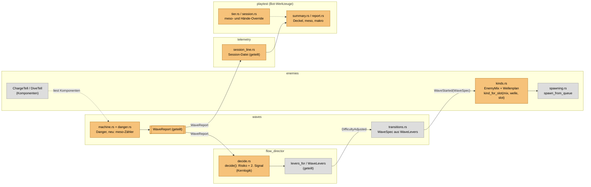
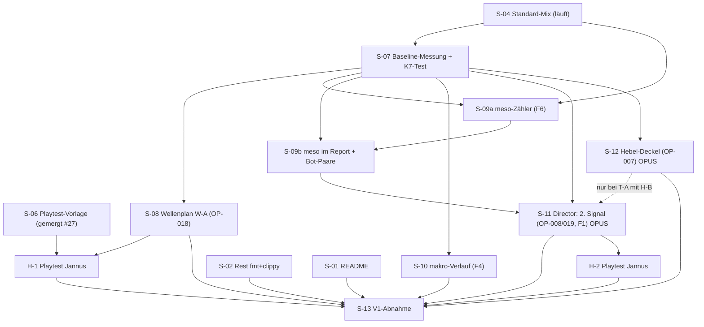

# PLAN Arena-flow – bis V1

> **Plan-Entwurf r2 (Planer, 2026-11-17, nach Kritik R1), teilweise entschieden.** Basis: Ist-Stand des Leiters (2026-11-10, Nachträge 2026-11-17), Repo-Stand main = #27 (Doku #26, Playtest-Vorlage #27); Code unverändert seit #22. Die Entscheidungen Jannus 2026-11-17 (Box) zu OP-009, OP-018 und OP-021 sind eingearbeitet (§7).
> Belegt ist, was eine Quelle hat (Pfad:Zeile, PR, Chat/Box Jannus). Alles mit **Vorschlag** oder **Annahme (Planer)** ist nicht entschieden; Jannus entscheidet, der Leiter stellt die Boxen und vergibt OP-IDs. Neue offene Fragen aus Kritik R1 stehen in §4.6 als **F1–F9** (OP-Text-Entwürfe ohne ID).
> Balance-Zahlen in diesem Plan sind nur **PLACEHOLDER-Vorschläge**. Pfad:Zeile geprüft am 2026-11-17 auf diesem Stand.
> Miro-/Canvas-Link: noch keiner.

## 0. Kurzfassung
- **V1 = fertiger Testaufbau für den Flow-Director** (Entscheidung Jannus, OP-001). Danach wird ein Spiel daraus; Game-Over, HUD, Menüs, Assets und echte Sounds gehören nach V1 (OP-016, OP-017).
- Was „fertig“ heißt, steht in Abschnitt 2 als prüfbare Kriterien K1–K9. **Entscheidung Jannus 2026-11-17: K1–K9 angenommen, Schwellen erst nach der Baseline S-07** (OP-021). Offen nach Kritik R1: was K2 tatsächlich belegt (F1, blockierend), K4 für makro (F3), Ausnahme der K9-Suche für die fehlende PNG (F7).
- Weg dorthin: erst messen (S-07 Baseline), dann Inhalte (S-08 Wellenplan), dann das Messinstrument erweitern (S-09a/b meso, S-10 makro), erst danach die Kernlogik des Directors anfassen (S-11, S-12, beide Opus), zum Schluss Kriterien als Tests (S-13).
- Laufend: S-04 (Standard-Gegnermix). S-06 (Playtest-Vorlage) ist als #27 gemergt. Bewusst offen: OP-003 (Pickup-Regelwerk) und OP-012 (fehlende Design-Dateien); der Plan trifft dazu keine Annahme, S-03 und S-05 bleiben geparkt.
- Entschieden (Jannus 2026-11-17): OP-009 (meso = M-B mit M-A-Spalte und M-C-Nachweis; makro in V1 = A-C + A-A) und OP-018 (W-A, Shooter → Brute → Summoner, Startwellen 6/10/14 PLACEHOLDER). Weiter **nicht entschieden**: OP-007, OP-008, OP-019 (Abschnitt 4, Optionen mit Empfehlung).

## 1. Ziel und Ist-Stand

### Ziel (laut README, Stand heute)
- 2D-Top-down-Wave-Arena als **Testaufbau für einen Flow-Channel-Difficulty-Director**: nach jeder Welle schiebt der Director die Schwierigkeit so, dass die nächste Welle knapp über der jüngsten Spielerleistung liegt (README.md:3–5).
- „This is a test harness, not a game.“ (README.md:7)
- Leitbild aus CLAUDE.md „Design north star“: „Simple on the surface, deep in mechanics and optimization“, Referenz Devil Daggers; der Director soll das Spiel für jede Skill-Stufe fordernd halten; Pickups haben immer einen Preis.
- Entscheidung Jannus 2026-11-10 (Box, OP-001): V1 ist erst der fertige Testaufbau für den Flow-Director, danach wird ein Spiel daraus.

### Kernidee: Flow-Modell (Quelle: Chat Jannus 2026-11-10)
Ersetzt inhaltlich die fehlende `design/risk-flow-curve.png` (OP-012).
- Klassischer Flow-Graph: x-Achse Skill, y-Achse Challenge, der Flow-Kanal verläuft diagonal nach oben rechts.
- Man ist im Flow, wenn die Challenge knapp über dem Skill liegt.
- Skill hat 3 Bereiche: **mikro** (Zielen und Bewegen), **meso** (Entscheidungen innerhalb einer Welle), **makro** (Strategie über viele Wellen).
- Der Director arbeitet wie ein komplexes System, passt sich automatisch an den Spielertyp an und hält ihn möglichst lange im Kanal (schwerer, aber nicht zu schwer).

### Ist-Stand im Code (geprüft 2026-11-17, main = #27, Code unverändert seit #22)
- **Director misst bisher nur mikro**, und zwar indirekt: `wave_risk` = Anteil der hp, den eine Welle kostet (1 bei Tod), geglättet und in ein Band gesteuert (src/flow_director/decide.rs:76–82, :103–117). Der Code sagt selbst: liest nur mechanischen Druck, Entscheidungen und Gegner-Lesen nicht (src/flow_director/curve.rs:5–8). Die Code-Kurve ist Risiko → Engagement, kein Skill-/Challenge-Graph.
- **Hebel:** genau drei (Anzahl, Tempo, Kontaktschaden), linear je Stufe (src/flow_director/decide.rs:140–156, `WaveLevers` in src/flow_director/difficulty.rs:107–113). Schwierigkeit 1,0–10,0 in Viertelschritten (src/flow_director/difficulty.rs:10–53).
- **Gedächtnis des Directors:** nur eine geglättete Risikozahl (`DirectorMemory`, src/flow_director/decide.rs:56–61).
- **meso:** wird nur gemessen, nicht gesteuert. `Danger` zählt Beinahe-Treffer, Treffer-Annäherungen, Bedrohungs- und Ruhezeit, Gedränge (src/waves.rs:97–120, Messung src/waves/danger.rs:24–63); ein „Beinahe-Treffer“ ist jeder Gegner oder Bolt, der bis auf 24 Einheiten herankommt und ohne Kontakttreffer wieder geht (src/waves/danger.rs:12–15, :29–30). Bot-Stufen haben Entscheidungs-Parameter wie Tells lesen und Prioritätsziel (src/playtest/tier.rs:148–175, `focuses_priority` :167, `reads_tells` :169). Novice und Casual lesen keine Tells, Skilled und Expert schon (Stufen-Tabelle ab src/playtest/tier.rs:192).
- **makro:** nur offline in den Bot-Werkzeugen: `strategy_search` prüft, ob eine Pickup-/Spend-Strategie überall gewinnt („macro difficulty as consequence“, src/playtest/strategy.rs:1–10). Der Director nutzt das nicht.
- **Spielertyp-Anpassung:** gibt es nicht (OP-019).
- **Gegnermix:** `EnemyMix` kennt `Grunts` (Default), `With(eine Art)`, `All` (src/enemies/kinds.rs:56–65); welche Art einen Slot füllt, hängt nur vom Mix und der Slot-Nummer ab, nicht von der Welle (src/enemies/kinds.rs:223–231, Aufruf src/enemies/spawning.rs:128). S-04 ändert den Default (läuft).
- **Messinstrument:** Der Bot-Report bewertet Wellen auf der Flow-Kurve (flow score, in flow, bored, overwhelmed; src/playtest/summary.rs:39–47) und zusätzlich gegen das Band des Directors: `Summary::of` nimmt `DirectorConfig::default()` (src/playtest/summary.rs:62). Beide Bewertungen lesen dieselbe Größe `wave_risk` (summary.rs:63), die der Director steuert (siehe §2, F1). Einen Anteil „Wellen am Deckel“ zeigt der Report nicht; die 57–70 % aus OP-007 stammen aus PR #12. Je Seed gibt der Report eine eigene Zeile aus (`"{tier} #{seed}"`, examples/playtest.rs:296–300); Default-Länge 10 simulierte Minuten (examples/playtest.rs:123, `--minutes` :142).
- **Agent-Playtests:** `agent_play` lässt einen Agenten jede Welle mit −2 (bored) bis +2 (overwhelmed) bewerten (`Feel`, src/playtest/agent_view.rs:251–258).
- **Tests:** `tests/playtest_tiers.rs` prüft nur expert > novice (Funktion ab :38), mit `EnemyMix::Grunts` (:25–27). Einen Test, der zwei gleiche `play`-Läufe vergleicht, gibt es nicht; es gibt aber einen Replay-Test für Agenten-Läufe (`a_replay_is_identical_every_time`, src/playtest/agent.rs:401). Bots nutzen einen geseedeten Zufallsgenerator (src/playtest/perception.rs:59–61), die Simulation keinen.
- **CI:** `cargo test` auf jedem PR und Push nach main seit #25 (`.github/workflows/test.yml`, ca. 16 min laut docs/STAND.md:3); fmt/clippy fehlen (OP-014).

### Erkennbare Nicht-Ziele (README.md:171–177, „Intentionally not built“)
- Game-Over-Screen, Run-Restart, Menüs außer dem Debug-Overlay
- Release-HUD (hp, aktive Effekte)
- Assets, Sprites, Animation, Fonts über Bevys Standard (Sound gibt es hinter `fx`, OP-013)
- Upgrades, Shops, Bosse, prozedurale Räume, Netzwerk, Spielstände
- Balance: jede Zahl ist Platzhalter

**Vorschlag (Planer):** Alle diese Punkte bleiben auch für V1 Nicht-Ziele, weil V1 der Testaufbau ist (OP-001); sie wandern in die Spiel-Phase danach (OP-016, OP-017). Ebenso kein Feinschliff der Balance über das hinaus, was ein Kriterium aus Abschnitt 2 verlangt (OP-005, OP-006).

## 2. Was „fertiger Testaufbau für den Flow-Director“ heißt – Erfolgskriterien
**Entscheidung Jannus 2026-11-17 (OP-021): K1–K9 angenommen; die Schwellen (PLACEHOLDER) werden erst nach der Baseline S-07 festgelegt.**
Vorschlag Planer (Kritik R1, B8): Weil die Kriterien-Läufe in S-13 mit dem Wellenplan (S-08) laufen, die Baseline S-07 aber mit dem S-04-Mix, legt Jannus die Schwellen nach S-07 fest und prüft sie nach dem Nachher-Report aus S-08 (Wellenplan, S-08 Punkt 5) einmal gegen. Das ist mit „erst nach S-07“ vereinbar.

**Messvorschrift** (gilt für S-07, S-08, S-11, S-13): Bot-Report `cargo run --release --example playtest -- --matrix --seeds 3 --minutes 10`, Standard-Gegnermix bzw. Wellenplan, Pickups `classic` (Default, solange OP-003 offen ist), Director an. Anteile je Stufe × Waffe **gepoolt über die Seeds** (Summe der betroffenen Wellen / Summe aller Wellen), Spannweite je Seed daneben (Annahme Planer, F9). `--matrix` = eigene Waffe der Stufe + drei feste Waffen (examples/playtest.rs:148–150).
Bewertet wird auf der Flow-Kurve (flow score, in flow, bored, overwhelmed), **nicht** mit „risk in band“, weil dieses Maß am Band des Directors selbst hängt (src/playtest/summary.rs:62; OP-022, Annahme Planer).
**Grenze (Kritik R1, B1):** Auch die Flow-Kurve liest `wave_risk`, also genau die Größe, die der Director glättet und in sein Band steuert (summary.rs:63–72, decide.rs:97–118). „In flow“ heißt engagement ≥ 0,6, also Wellen-Risiko r zwischen 0,30 (r/0,5 ≥ 0,6) und 0,585 (e^(−6(r−0,5)) ≥ 0,6), curve.rs:10–27; das Band liegt auf geglättetem Risiko bei 0,35–0,65 (decide.rs:29–30) und wurde laut Kommentar per Bot-Suche auf „most waves near the peak“ gewählt (decide.rs:25–27). Ein funktionierender Regler erfüllt K2 damit nahezu per Konstruktion; K2 misst heute Regelgüte, nicht Flow. Was K2 belegen soll, ist **offen, siehe F1** (blockierend für S-11 und die K2-Schwelle in S-13).

| Nr. | Kriterium (angenommen) | Prüfung (Slice, Schritt) | Schwelle (PLACEHOLDER, Festlegung nach S-07) |
|---|---|---|---|
| K1 | **Rangfolge:** Der Director ordnet alle vier Bot-Stufen streng steigend ein (settled diff novice < casual < skilled < expert). | Report über 3 Seeds (S-07 Punkt 6, zeigt, ob die Ordnung über Seeds hält); Test in `tests/playtest_tiers.rs` (S-13 Punkt 1) | streng monoton, 1 Seed, 4 sim. Minuten wie heute; heute getestet ist nur expert > novice (tests/playtest_tiers.rs:38–53). Ist die Ordnung in S-07 nicht über alle Seeds stabil, entscheidet Jannus bei der Schwelle (mehr Seeds oder Toleranz) |
| K2 | **Im Kanal je Stufe:** jede Stufe verbringt einen Mindestanteil der Wellen im Flow und wenig gelangweilt oder überfordert. | Flow-Tabelle (S-07 Punkt 6 Baseline, S-13 Punkt 5); **Aussagekraft offen, siehe F1**; Stufen am Rand siehe F2 | in flow ≥ 50 %, bored ≤ 20 %, overwhelmed ≤ 20 % je Stufe |
| K3 | **Kein Deckel-Anschlag:** Skilled/Expert stehen selten am Deckel (Difficulty 10), auch mit der stärksten Waffe. | Spalte „am Deckel“ (S-07 Punkt 2), `--matrix`; Test S-13 Punkt 1 mit der stärksten Waffe. **Stärkste Waffe** = die Waffe mit dem höchsten Deckel-Anteil je Stufe in der letzten Baseline (Vorschlag Planer; laut OP-007 bisher Hitscan) | ≤ 10 % der Wellen je Stufe × Waffe, gepoolt über Seeds |
| K4 | **Drei Skill-Bereiche getrennt messbar:** der Report zeigt je Session mikro, meso und makro als eigene Zahlen (Definition aus OP-009); je Bereich ein Bot-Paar, das sich nur dort unterscheidet und messbar verschieden abschneidet. | mikro: bestehende Spalten (Trefferquote, Risiko) + Bot-Paar „nur Hände verschieden“ (S-09b Punkt 3b); meso: Spalte + Bot-Paar „nur Tells an/aus“ (S-09b Punkt 3a, M-C); makro: Spalte A-A (S-10), Bot-Paar nur offline über A-C (`strategy_search`) möglich, **offen, siehe F3** | Spalten vorhanden; je Paar Unterschied in der eigenen Zahl, in der fremden Zahl höchstens PLACEHOLDER 5 Prozentpunkte |
| K5 | **Spielertyp-Reaktion** (nur falls OP-019 nicht „nicht in V1“): zwei Bots mit gleichen Händen, aber verschiedenem meso-Verhalten, bekommen messbar verschiedene Wellen (Hebel oder Mix). | Integrationstest in S-11 Punkt 6 (Bot-Paar aus dem Override von S-09b), in S-13 nur mitgelaufen | Unterschied in mindestens einem Hebel über die zweite Hälfte |
| K6 | **Mensch im selben Instrument:** Jannus' Sessions erscheinen mit `--human` in denselben Tabellen; mindestens zwei menschliche Playtests mit Vorlage (S-06, #27), einer davon ≥ 15 min. | H-1, H-2: Notiz nach playtest-notes/VORLAGE.md + `--human`; S-13 Punkt 5 trägt das Ergebnis ein | Feld „Flow (1-10): … Ende“ der Vorlage ≥ 6 in beiden (Vorschlag Planer: Endwert, weil er die ganze Session abdeckt) |
| K7 | **Reproduzierbar:** zwei gleiche Report-Läufe liefern identische Tabellen. | Test ab S-07 (Punkt 4: `play` zweimal, `Summary` gleich); manuell: Report-Lauf wiederholt (S-07 Punkt 7) | identisch |
| K8 | **Technik grün:** `cargo fmt --check`, `cargo clippy --all-targets -- -D warnings`, `cargo test` laufen in CI (OP-014). | CI (S-02 Rest) | grün |
| K9 | **Doku stimmt:** README und ARCHITECTURE beschreiben den Code (keine Treffer der verworfenen Begriffe aus Abschnitt 8). | K9-Suche aus Abschnitt 8 (nur README.md, ARCHITECTURE.md), S-13 Punkt 4; Begriffe ohne festen Wortlaut per Kritiker-Durchsicht | 0 Treffer; Ausnahme `design/risk-flow-curve.png` **offen, siehe F7** |

Anmerkungen:
- K2 für Novice kann an der Untergrenze (Difficulty 1) scheitern, K2 für Skilled/Expert am Deckel (PR #12 nannte für Skilled/Expert einen flow score von 0,12/0,10, älterer Stand mit reinen Grunts, Commit 6ce6a53; ein Mittel von 0,10 ist mit ≥ 50 % Wellen bei engagement ≥ 0,6 unvereinbar). Der Report zeigt beides als „am Boden“/„am Deckel“ (S-07). Was K2 für Stufen am Rand heißt, auch bei OP-007 = H-C, ist **offen, siehe F2**.
- K6 ist subjektiv und eine Person; als Gegengewicht zu den Bots gedacht, nicht als Messung.
- **Pickups:** Die Kriterien gelten mit `classic`, weil OP-003 bewusst offen ist. Ob V1 ohne entschiedenes Pickup-Regelwerk „fertig“ sein kann, ist offen (OP-024), keine Annahme dieses Plans.
- Weitere Kriterien zu „hält ihn möglichst lange im Kanal“ (Stabilität, Skill-Wechsel in einer Session) fehlen; **offen, siehe F8**.

## 3. Architektur der V1-Änderungen

### Betroffene Domänen
| Domäne / Teil | Was sich in V1 ändert (je nach gewählter Option) | Slices |
|---|---|---|
| `enemies` (kinds.rs, spawning.rs) | Default-Mix (S-04); Wellenplan: Art je Slot hängt zusätzlich vom Wellenindex ab | S-04, S-08 |
| `waves` (waves.rs, machine.rs, danger.rs, transitions.rs) | neue meso-Zähler in `WaveReport` (Tells gesehen/ausgewichen) | S-09a |
| `flow_director` (decide.rs, difficulty.rs, flow_director.rs) | zweites Signal (Danger/meso), ggf. neuer Hebel oder Deckel | S-11, S-12 |
| `telemetry` (session_line.rs) | neue Felder in der Session-Datei, alte Dateien müssen lesbar bleiben; neuer Entscheidungsgrund | S-09a, S-11 |
| `playtest` (summary.rs, report.rs, session.rs) | Spalten „am Deckel/am Boden“, meso, makro; Override für meso-Verhalten und Hände in `SessionConfig` | S-07, S-09b, S-10 |
| `examples/playtest.rs`, `examples/strategy_search.rs`, `tests/playtest_tiers.rs` | Default-Mix, `SessionConfig`-Literale, Abnahmetests | S-07, S-08, S-09b, S-13 |
| unverändert | `app_setup`, `arena`, `camera`, `player`, `weapons`, `combat`, `pickups`, `debug_render`, `fx` | – |

### Datenfluss V1 (Mermaid)
Orange = ändert sich in V1, grau = unverändert, gestrichelt = Lesen ohne Message bzw. Bot-Werkzeuge (kein Gameplay-Plugin).

`LEVERS` wird nur orange, wenn OP-007 einen neuen Hebel wählt (S-12) oder OP-019 die Variante T-A0 (Hebelverteilung nach Signal). `TRANS` ändert in S-09a nur das `WaveReport`-Literal in `report()` (src/waves/transitions.rs:70–93), nicht den Ablauf. `waves` liest Gegner-Komponenten heute schon (src/waves/danger.rs:30), ein Lesen der Tell-Komponenten wäre also kein neuer Abhängigkeits-Typ; ob das reicht oder ein Fakt aus `enemies` nötig ist, klärt S-09a beim Pfade-Prüfen.

### Geteilt (Risikoliste Nr. 1)
Jede Slice, die eins davon ändert, ist Risiko → Kritikrunde vor dem Merge.

| Nr. | Geteiltes Element | Fundstelle | Wer hängt dran |
|---|---|---|---|
| G1 | `WaveReport` (Struktur) | src/waves.rs:69–95 | flow_director (`decide`, `wave_risk`), telemetry (Session-Datei), playtest (summary, agent_view); Struktur-Literale: Produktivcode src/waves/transitions.rs:70–93, src/telemetry/session_line.rs:179 und Test :282, Tests src/flow_director/decide.rs:173–192, src/playtest/summary.rs:154 (decide.rs:214/:221 nutzen `..report(..)` und brauchen nichts) |
| G2 | `Danger` | src/waves.rs:97–120 | Session-Datei (`#[serde(default)]`, src/telemetry/session_line.rs:35–37), Report |
| G3 | `WaveLevers`, `DifficultyAdjusted`, `DecisionReason` | src/flow_director/difficulty.rs:74–126 | waves (src/waves/measure.rs:19, src/waves/transitions.rs:106–113), telemetry (Grund als Text in der Session-Datei, Tabelle `DECISIONS` + `decision_name` src/telemetry/session_line.rs:228–248, `parse_decision` :259), `Summary::in_band` zählt nur `HeldInBand` (src/playtest/summary.rs:105), Watch-Label |
| G4 | `WaveSpec` | src/waves.rs:39–49 | enemies (Spawn-Queue src/enemies/spawning.rs:95–102, Werte je Art) |
| G5 | `Difficulty` (MIN/MAX, Viertelschritte) | src/flow_director/difficulty.rs:10–53 | überall; `--sweep` zählt fest 1..=10 (examples/playtest.rs:154) |
| G6 | `EnemyMix` + `ARENA_ENEMIES` / `--enemies` | src/enemies/kinds.rs:51–102, src/enemies.rs:64–69 | playtest (session.rs, watch.rs), examples/playtest.rs:184–186, :284, :349–351, :390–392, examples/strategy_search.rs:75 |
| G7 | `DirectorConfig::default()` als Maßstab des Reports | src/flow_director/decide.rs:6–37, src/playtest/summary.rs:62 | jede Änderung am Band ändert „risk in band“ im Report |
| G8 | Session-Datei-Format | src/telemetry/session_line.rs | Jannus' alte `playtests/*.jsonl` müssen mit `--human` lesbar bleiben |
| G9 | Flow-Kurve `engagement`, `FLOW_PEAK`, `IN_FLOW` | src/flow_director/curve.rs:10–27 | Report-Bewertung, damit alle Kriterien aus Abschnitt 2 |
| G10 | `SessionConfig` (Struktur ohne `Default`, alle Felder ausgeschrieben) | src/playtest/session.rs:26–45 | Literale in tests/playtest_tiers.rs:10, examples/playtest.rs:253, examples/strategy_search.rs:154; ein neues Feld bricht alle drei |

Weitere Risiko-Gründe: Kernlogik = `decide()` und `levers_for()` (Risikoliste Nr. 3), Opus-Slices (Nr. 4), Lösch-Code in S-05 (Nr. 2).

## 4. Richtungsfragen mit Optionen
Jede Frage: Optionen, Vor-/Nachteile, Empfehlung des Planers. **Jannus entscheidet.** Messen vor Umbauen: Die Empfehlungen setzen voraus, dass S-07 (Baseline) vorher läuft. Prüfmaßstab CLAUDE.md „Design north star“: Tiefe ohne mehr Oberfläche; die Spalte „Oberfläche“ sagt, ob der Spieler etwas Neues sieht.

### 4.1 OP-009 · Wie werden meso und makro gemessen? – **entschieden**
**Entscheidung Jannus 2026-11-17 (Box):** meso = M-B (Tells gesehen/ausgewichen je Welle), dazu Danger-Spalte M-A und Bot-Paar Tells an/aus als Nachweis M-C; makro in V1 = A-C (offline über `strategy_search`) + A-A (Verlaufs-Spalte im Report); Pickup-makro A-B erst nach OP-003. Die Optionen bleiben zur Nachvollziehbarkeit stehen.

**meso (Entscheidungen innerhalb einer Welle)**

| Option | Idee | Vorteile | Nachteile |
|---|---|---|---|
| M-A Aus Danger ableiten | Ausweichquote = Beinahe-Treffer / (Beinahe-Treffer + Treffer-Annäherungen), dazu Ruhezeit-Anteil; alles schon in `Danger` | kein neuer Zähler, schon in Report und Session-Datei, kein Risiko | mischt mikro (Bewegen) und meso; sieht keine Entscheidung direkt |
| M-B Entscheidungs-Ereignisse zählen | je Welle: Tells gesehen / Tells ausgewichen (Charger-Dash, Swarm-Dive), optional Zeit bis ein Summoner fällt | misst genau die Bot-Parameter `reads_tells` / `focuses_priority`, damit validierbar; passt zum Standard-Mix Charger + Swarm (OP-002) | neue Felder in `WaveReport` (G1) und Session-Datei (G8), neue PLACEHOLDER (was zählt als „gesehen“/„ausgewichen“, F6), hängt am Gegnermix |
| M-C Bot-Vergleich offline | meso = Unterschied im Ergebnis zwischen Bot mit und ohne meso-Verhalten bei gleichen Händen und gepinnter Schwierigkeit | sauber getrennt, kein Gameplay-Code | nur offline; der Director und menschliche Spieler bekommen keine Zahl |

**Grenze der Validierung (Kritik R1, B9), Annahme Planer:** Das Bot-Paar Tells an/aus prüft die Zahl gegen genau den Bot-Parameter, der das Ausweichen auslöst (`reads_tells`, src/playtest/bot.rs:228). Das belegt Trennschärfe gegenüber mikro (zusammen mit dem Hände-Paar, S-09b Punkt 3b), nicht, dass die Zahl menschliches meso misst. Die Gegenprobe am Menschen gibt es nur über H-1/H-2. Wann ein Tell als „gesehen“ zählt, ist offen (F6), weil der Charger-Tell schon bei 400 Einheiten Abstand startet (`CHARGE_TRIGGER_RANGE`, src/enemies/movement.rs:16, Auslösung :99) und ein ungefährlicher Dash sonst als „ausgewichen“ zählt.

**makro (Strategie über viele Wellen)**

| Option | Idee | Vorteile | Nachteile |
|---|---|---|---|
| A-A Verlauf über Wellen | Trend der eigenen Leistung über die Session (z. B. Trend, Erholung nach Tod) | sofort als Spalte messbar, unabhängig von Pickups | misst eher Lernen und Anpassung als Strategie; aus `wave_risk`/Schwierigkeit abgeleitet, also nicht getrennt von mikro; Bots lernen nicht, ein Bot-Paar nur für makro gibt es dafür nicht; Messdefinition offen (F4) |
| A-B Ressourcen-Entscheidungen über Wellen | Pickup-/Shard-Timing, Sparen vs. Ausgeben als makro-Zahl | trifft das Devil-Daggers-Leitbild (Tiefe aus Gem-Sammeln) | **hängt an OP-003**, das bewusst offen ist; vorher nicht schneidbar |
| A-C makro nur offline in V1 | `strategy_search` bleibt das makro-Maß, der Director nutzt makro in V1 nicht | ehrlich, kein Umbau, Werkzeug existiert; Strategie-Paare mit gleichen Händen sind dort schon eingebaut (`pickup_policy`/`spend`, examples/strategy_search.rs:154–165) | Jannus' Modell hat drei Bereiche, live gemessen wären nur zwei; Default dort ist `shards` (examples/strategy_search.rs:72), mit `classic` ist ein messbarer Unterschied nicht gemessen |

Folge für K4 makro: siehe F3.

### 4.2 OP-008 · Geht Danger in die Steuerung?
| Option | Idee | Vorteile | Nachteile | Oberfläche |
|---|---|---|---|---|
| D-A Nein, nur Report (Ist) | Director bleibt bei `wave_risk` | Kernlogik stabil, ein klares Signal | eine Welle ohne Schaden, aber mit viel Bedrohung liest als „bored“; der Director erhöht, obwohl der Spieler gefordert war | nichts Neues |
| D-B Danger in die Risikozahl mischen | Risiko = `wave_risk` + Gewicht × normierte Beinahe-Treffer (Gewicht PLACEHOLDER) | `decide()` behält seine Form, leicht zu testen | mischt Einheiten, ein Gewicht mehr zu tunen, hp-Risiko und Gedränge gleichen sich unsichtbar aus; K2 würde mitverschoben | nichts Neues |
| D-C Danger als Bremse | „anheben“ nur, wenn die Welle auch ruhig war (Bedrohungszeit-Anteil unter PLACEHOLDER); neuer Entscheidungsgrund | asymmetrisch und vorsichtig, Grund bleibt lesbar, ändert nichts an „zu riskant“/„Tod“ | neue `DecisionReason`-Variante (G3, Text in Session-Datei), ein Zustand mehr; hält absichtlich Wellen, die auf der Flow-Kurve „bored“ sind, verschlechtert also K2 (B1, F1) | nur Text im Debug-Overlay |
| D-D Zweites Band auf der Danger-Achse | eigenes Band für den Bedrohungszeit-Anteil; anheben nur, wenn beide Signale unter ihrem Band, senken, wenn eins darüber (Hysterese, nicht additiv) | symmetrisch, sieht auch „gedrängt, aber ohne Schaden“-Überforderung | zwei Bänder zu tunen, mehr Kernlogik als D-C; senkt auch bei hp-sicheren Wellen; dieselbe K2-Wirkung wie D-C | nur Text im Debug-Overlay |

**Empfehlung:** Erst mit S-07 messen, ob es „bored, aber knapp“-Wellen überhaupt nennenswert gibt (Definition und Schwelle: F5). Wenn ja: D-C (S-11), weil kleiner als D-D. Wenn nein: D-A, OP-008 schließen. Woran S-11 seinen Erfolg misst, hängt an F1.

### 4.3 OP-007 · Hebel-Deckel
| Option | Idee | Vorteile | Nachteile | Oberfläche |
|---|---|---|---|---|
| H-A Deckel anheben | `Difficulty::MAX` über 10, Hebel linear weiter | klein im Code | nur „mehr vom Gleichen“ (Anzahl, Tempo, Schaden); `Difficulty` ist geteilt (G5), `--sweep` zählt fest 1..=10; Tempo-Grenzen (z. B. `dash_cap`, src/enemies/movement.rs:50) müssen mit | nichts Neues |
| H-B Neuer Hebel Zusammensetzung | höhere Stufe = mehr Sonderarten im Mix | nutzt vorhandene Arten, Tiefe aus Gegner-Design | Kernlogik und `enemies` hängen enger zusammen (`WaveLevers` bekommt ein Feld, G3/G4); sinkt die Stufe, verschwinden Arten wieder; macht aus dem entschiedenen W-A ein W-C, öffnet also OP-018 wieder | mehr Arten früher |
| H-C Deckel akzeptieren | Experten am Deckel = „Testaufbau zu leicht für diese Stufe“, als Ergebnis ausgewiesen | kein Risiko | K3 fällt weg oder wird aufgeweicht; K2 für Skilled/Expert ist dann vermutlich nicht erreichbar (Anmerkung in §2), Umgang offen (F2) | nichts Neues |
| H-D Neuer Hebel Gleichzeitigkeit | Spawn-Intervall bzw. Zahl gleichzeitig aktiver Gegner wird ein Hebel; heute feste Konstante `SPAWN_INTERVAL_SECS` = 0,35 s (src/enemies/spawning.rs:13) | kein neuer Inhalt, wirkt mit jedem Mix, keine verschwindenden Arten, berührt OP-018 nicht; mehr Gedränge verlangt Prioritäten (meso) | Kernlogik + `WaveLevers`/`WaveSpec` (G3/G4) wie H-B; ändert `Danger` (Gedränge, Bedrohungszeit), vermischt sich also mit D-C/D-D | nichts Neues |

**Empfehlung:** Erst S-07: die 57–70 % stammen aus PR #12, mit reinen Grunts und vor Charger-Cap und Swarm. Bleibt der Anteil mit Standard-Mix über der K3-Schwelle: H-D, weil er OP-018 nicht wieder öffnet und mit dem Wellenplan zusammenpasst; H-B nur, wenn Jannus Zusammensetzung ausdrücklich als Hebel will (dann zusammen mit OP-018 als W-C). Liegt der Anteil darunter: H-C. Ob H-A dem Leitbild widerspricht, bewertet Jannus; der Planer empfiehlt ihn nicht, weil er nur bestehende Hebel verlängert.

### 4.4 OP-019 · Spielertyp
| Option | Idee | Vorteile | Nachteile | Oberfläche |
|---|---|---|---|---|
| T-A Skill-Vektor statt Typ | Director führt mikro und meso getrennt geglättet und wählt danach den Hebel (hoch mikro, niedrig meso → mehr Masse; hoch meso → mehr Sonderarten) | folgt direkt aus der Messung, testbar mit Bot-Paaren (K5) | braucht einen Hebel „Sonderarten“ (OP-007 H-B, S-12 vor S-11), mehr Kernlogik | nichts Neues |
| T-A0 Skill-Vektor auf den drei vorhandenen Hebeln | wie T-A, aber die Schrittweite verteilt sich je nach Signal anders auf Anzahl vs. Tempo/Schaden (z. B. hoch mikro, niedrig meso → mehr Anzahl) | kein neuer Hebel, unabhängig von OP-007/S-12; K5 („Unterschied in mindestens einem Hebel“) ist damit prüfbar | `levers_for` hängt dann nicht mehr nur an der Schwierigkeit (G3); welche Hebel zu meso passen, wäre eine neue Annahme | nichts Neues |
| T-B Feste Typ-Profile | Session wird einem Profil zugeordnet (Namen von Jannus), Profil setzt Gewichte der Hebel | für Menschen gut erklärbar, Grund im Overlay lesbar | Schwellen der Zuordnung wären erfunden (PLACEHOLDER), harte Sprünge, kaum menschliche Daten zum Prüfen | Profilname im Overlay |
| T-C Nicht in V1 | V1 passt sich an eine Zahl an, Spielertyp kommt mit dem Spiel | V1 kleiner, weniger Kernlogik-Risiko | ein Kernsatz aus Jannus' Flow-Modell bleibt offen | nichts Neues |

**Empfehlung:** T-A0, aber nur, wenn S-09b zeigt, dass meso sich messbar von mikro trennt (beide Bot-Paare). Dann entfällt die Abhängigkeit S-12 → S-11. T-A nur, falls Jannus für OP-007 H-B wählt. Zeigt S-09b keine Trennung: T-C, K5 entfällt.

### 4.5 Gegnermix-Fallback (Kritik R1, B13)
Hinweis, keine Entscheidung nötig: Ein unbekannter Name in `ARENA_ENEMIES` fällt im Spiel heute still auf den Default zurück (`parse().ok()` + `unwrap_or_default()`, src/enemies.rs:64–67); eine Fehlermeldung gibt es nur für `--enemies` im Beispiel (src/enemies/kinds.rs:94–99). Mit dem Wellenplan als Default wird ein Tippfehler im Spiel unbemerkt zum Wellenplan. S-08 ändert daran nichts (Verhalten wie heute); falls Jannus eine Warnung will, eigene kleine Slice.

### 4.6 Neue offene Fragen aus Kritik R1 (OP-Text-Entwürfe, IDs vergibt der Leiter)
| F | Frage | Typ (Vorschlag) | Optionen | Empfehlung Planer | blockiert |
|---|---|---|---|---|---|
| F1 | **K2 ist zirkulär:** „in flow“ liest `wave_risk`, die Größe, die der Director selbst in sein Band steuert (Fenster r 0,30–0,585 gegen Band 0,35–0,65, Band per Bot-Suche auf diese Zahl optimiert, decide.rs:25–30). K2 belegt so Regelgüte, nicht Flow; eine Danger-Bremse (D-C) würde K2 absichtlich verschlechtern. Was soll K2 belegen, und woran misst S-11 seinen Erfolg? | blockierend | **A** K2 bleibt wie angenommen, heißt aber „Regelgüte“ (Director hält jede Stufe auf der hp-Kurve); Flow-Nachweis nur über K6 (Mensch). **B** K2 bekommt ein vom Director unabhängiges Zusatzmaß: Agent-Playtests mit `Feel` −2..+2 je Welle (agent_view.rs:251–258), Anteil Wellen mit Feel 0 je Hand-Stufe; nicht deterministisch, teuer, nicht in CI. **C** K2 auf ein Danger-Maß umstellen (z. B. Anteil Wellen mit Bedrohungszeit-Anteil in einem Fenster); unabhängig vom heutigen Signal, wird aber selbst zirkulär, sobald D-B/D-C/D-D Danger steuert. | **A**, dazu für S-11 vorab festlegen: Erfolg = weniger Tode/overwhelmed-Wellen direkt nach einem „anheben“ bei unverändertem K1, plus H-2 (Mensch); K2-Vergleich vorher/nachher gilt für S-11 ausdrücklich nicht als Erfolgsmaß. B als spätere Ergänzung | S-11 (Erfolgsmaß), S-13 (K2-Schwelle) |
| F2 | **Stufen am Rand:** Novice am Boden (Difficulty 1) und Skilled/Expert am Deckel können K2 nicht erfüllen, weil der Director dort nicht mehr regeln kann; bei OP-007 = H-C gilt das dauerhaft. Was gilt dann für K2? | später | **a** K2 gilt ohne Ausnahme (H-C damit praktisch ausgeschlossen, Novice am Boden = Fehlschlag). **b** Stufen mit Rand-Anteil über einer Schwelle werden als „außerhalb des Regelbereichs“ ausgewiesen, K2 gilt für sie nicht, K3 deckt den Rand ab. **c** K2 nur über Wellen rechnen, in denen der Director Spielraum hatte. | **b**, mit den S-07-Zahlen zusammen mit den Schwellen entscheiden | Schwellen K2/K3 (nach S-07) |
| F3 | **K4 makro** ist mit A-C + A-A nicht wie angenommen erfüllbar: A-A (Report-Spalte) ist aus `wave_risk`/Schwierigkeit abgeleitet und hat kein Bot-Paar, das sich nur in makro unterscheidet (Bots lernen nicht). | später | **a** K4 makro = A-C: Bot-Paar in `strategy_search` (gleiche Stufe und Hände, verschiedene `pickup_policy`, `--rules classic`, gepinnte Schwierigkeit); A-A bleibt informative Spalte ohne K4-Anspruch. **b** A-A selbst validieren über `agent_play` mit steigendem `skill LEVEL`; ändert aber die Hände (mikro), braucht neues Werkzeug, nicht in V1. **c** K4 in V1 nur für mikro und meso, makro nach OP-003. | **a**; ob `classic` einen messbaren Unterschied liefert, misst S-10 Punkt 4 einmal | S-13 (K4 makro) |
| F4 | **Messdefinition A-A** (Trend und Erholung nach Tod) ist Inhalt, nicht Executor-Wahl. | blockierend | **a** Trend über die Schwierigkeit: mittlere Schwierigkeit letztes Drittel minus mittleres Drittel (erstes Drittel = Einschwingen); Erholung = Wellen nach einem Tod, bis die Schwierigkeit von vor dem Tod wieder erreicht ist. **b** Trend über das Risiko bei gleicher Schwierigkeit (Steigung von `wave_risk` je Stufe gepoolt); wenig Daten je Stufe, und der Director hält das Risiko absichtlich flach. **c** nur Erholung (wie r1: Wellen, bis das Wellen-Risiko wieder im Flow liegt), kein Trend. | **a**, weil der Director Leistungsänderung in Schwierigkeit umsetzt, nicht in Risiko; bei Bots erwartet flach (kein Lernen) | S-10 |
| F5 | **„bored, aber knapp“** für die OP-008-Entscheidung: Was ist „knapp“, und ab wann ist es „nennenswert“? `close_calls > 0` trennt bei vielen Gegnern vermutlich kaum (jeder Gegner/Bolt bis 24 Einheiten zählt, danger.rs:12–15), und S-11 steuert über den Bedrohungszeit-Anteil, nicht über close calls. | Annahme | **a** knapp = `close_calls > 0` (r1). **b** knapp = Bedrohungszeit-Anteil (`threat_secs`/`duration_secs`) der bored-Welle mindestens so hoch wie der Median der in-flow-Wellen derselben Stufe (keine erfundene Zahl, misst dasselbe wie D-C). **c** feste Schwelle PLACEHOLDER. Nennenswert jeweils ≥ 10 % aller Wellen einer Stufe (PLACEHOLDER). | **b** + 10 %, vor dem S-07-Lauf festhalten; S-07 weist a und b aus | OP-008-Entscheidung |
| F6 | **Wann zählt ein Tell als „gesehen“/„ausgewichen“?** Der Charger-Tell startet bis 400 Einheiten Abstand (movement.rs:16); ein Dash, der den Spieler nie gefährdet, zählt in r1 als „ausgewichen“, die Quote drängt zu 100 %. | Annahme | **a** wie r1: Tell endet ohne Kontakttreffer dieses Gegners. **b** gezählt wird nur ein gefährdender Tell: Charger, wenn der Spieler beim Ende des Wind-ups höchstens PLACEHOLDER Einheiten von der Dash-Linie (`ChargeTell.aim`, src/enemies.rs:26–32) und in Dash-Reichweite ist; Swarm-Dive zielt auf den Spieler und zählt wie a. **c** nur Tells innerhalb eines festen Abstands PLACEHOLDER. | **b** | S-09a |
| F7 | **K9 und `design/risk-flow-curve.png`:** Die Verweise in README.md:88, ARCHITECTURE.md:214, src/flow_director/curve.rs:1 bleiben, solange OP-012/S-03 offen ist; K9 „keine Treffer“ wäre damit unerreichbar. | später | **a** bekannte Ausnahme bis OP-012; K9 gilt ohne diesen Begriff, V1 kann mit dem Verweis fertig sein. **b** S-13 ersetzt die drei Verweise durch einen Verweis auf `flow_director::engagement`; greift OP-012 vor. **c** K9 und damit V1 warten auf OP-012/S-03. | **a** | S-13 (K9) |
| F8 | **Fehlende Kriterien** zum Auftrag „hält ihn möglichst lange im Kanal“: Stabilität (Flackern der Schwierigkeit) und Reaktion auf Skill-Wechsel innerhalb einer Session. | später | **a** als neue Kriterien aufnehmen, Schwellen nach S-07. **b** nur zeigen, ohne Kriterium: Stabilität über die vorhandene Spannweite der zweiten Hälfte (`settled_range`, src/playtest/summary.rs:26, im Report report.rs:30–31). **c** nicht in V1. | **b** für Stabilität (kein Code), **c** für Skill-Wechsel (braucht `agent_play`, nicht die Bot-Stufen) | – |
| F9 | **Messvorschrift Report:** Minuten je Session und Zusammenfassung über Seeds sind nicht festgelegt (Report gibt je Seed eine Zeile aus, examples/playtest.rs:296–300). | Annahme | **a** 10 min (Default), 3 Seeds, Anteile gepoolt (Summe Wellen / Summe Wellen), Spannweite je Seed daneben. **b** je Seed; Kriterium muss in jedem Seed halten (strenger, rauschanfälliger). **c** Median der Seeds. | **a**; Laufzeit misst S-07 | S-07 (Auswertung) |

## 5. Wellenplan weitere Gegnerarten (OP-018) – **entschieden**
**Entscheidung Jannus 2026-11-17 (Box):** W-A nach Wellenindex, Reihenfolge Shooter → Brute → Summoner, Startwellen 6/10/14 als PLACEHOLDER (nach S-07 messen). Umsetzung S-08.
Entschieden (OP-002): Start mit Grunt + Charger + Swarm. Heute kann `kind_for_slot` die Welle nicht sehen (src/enemies/kinds.rs:223–231); `WaveSpec` mit `index` liegt beim Spawnen aber schon in der Queue (src/enemies/spawning.rs:95–102), der Umbau bleibt also lokal in `enemies`.

| Option | Idee | Vorteile | Nachteile |
|---|---|---|---|
| W-A Nach Wellenindex (**gewählt**) | feste Zeitleiste wie in Devil Daggers: neue Art ab Welle N, bleibt danach drin | einfach, deterministisch, lesbar, nur `enemies` betroffen | Welle ≠ Können: Novices bleiben lange in frühen Wellen (Wiederholung nach Tod behält den Index, src/waves/transitions.rs:101–103); jede neue Art ist ein Sprung im Risiko, den der Director erst nachregeln muss |
| W-B Nach Schwierigkeit | Art ab Stufe X, also ein Director-Hebel (= OP-007 H-B) | Zusammensetzung wächst mit dem Können, gibt Experten Luft unter dem Deckel | Kernlogik; Arten verschwinden, wenn die Stufe fällt (Flackern); Inhalt und Director-Tuning vermischt |
| W-C Hybrid | Freischalten nach Wellenindex (bleibt), Anteil nach Schwierigkeit | Fortschritt und Skalierung | zwei Stellschrauben zu tunen, größte Slice |

Ob die Startwellen in den Mess-Läufen überhaupt erreicht werden, ist nicht gemessen. Grobschätzung (Annahme, nicht gemessen): Welle ≈ 2,5 s Pause (src/waves/transitions.rs:8) + Spawn n × 0,35 s (n = 4 + 2(d−1), decide.rs:143–152, spawning.rs:13) + Kampfzeit, also grob 10–20 s je Welle, 12–24 Wellen in 4 min; Novice mit Toden weniger. S-07 Punkt 6 misst das (`furthest_wave`, summary.rs:22).

## 6. Slices bis V1

### Reihenfolge und Abhängigkeiten

- Kante S-07 → S-09a (neu): beide ändern Test-Literale bzw. Tests in src/playtest/summary.rs; S-09a startet nach dem Merge von S-07.
- Parallel möglich (keine gemeinsame Datei): S-01 ∥ S-07; S-08 ∥ S-09a (S-08 ändert `enemies`, examples/playtest.rs und `tests/playtest_tiers.rs`, S-09a `waves`, `telemetry` und Test-Literale in decide.rs/summary.rs; Annahme (Planer): keine gemeinsame Datei, vor Start mit `git diff --stat` beider Branches prüfen). **Nicht parallel:** S-07 ∥ S-09a (summary.rs), S-07 ∥ S-09b ∥ S-10 (alle `summary.rs`/`report.rs`), S-08 ∥ S-09b (beide examples/playtest.rs und tests/playtest_tiers.rs), S-11 ∥ S-12 (beide `decide.rs`).
- Aufwände sind wie in docs/OP.md Laufzeit des Umsetzers in Minuten (Kopfzeile OP.md), keine Tool-Calls. Am oberen Rand: S-07 (Report-Läufe), S-08, S-09a (≥ 6 Literal-Stellen). Die Laufzeit eines Report-Laufs ist nicht gemessen; S-07 misst sie einmal (Punkt 5) und trägt sie in die Baseline ein. CI braucht für `cargo test` ca. 16 min (docs/STAND.md:3).

### Laufend bzw. erledigt (nicht neu planen)
- **S-04 · Standard-Gegnermix Grunt + Charger + Swarm** – läuft. Für S-07 wichtig: ob S-04 auch den Default in `examples/playtest.rs:184–186` und `tests/playtest_tiers.rs:25–27` umstellt. Falls nicht, übernimmt S-07 Punkt 1.
- **S-06 · Playtest-Vorlage** – gemergt als #27 (playtest-notes/VORLAGE.md). Grundlage für H-1/H-2 und K6. Offen dazu: OP-020 (Annahme, eine Spalte „Hebel / Kriterium“).

### Doku/Infra (Texte in Anhang A)
- **S-01 · README an den Code angleichen** – gültig, sonnet low, ca. 5–10 min, S, OP-013. Empfehlung: nach S-04 laufen lassen, damit der neue Default gleich drinsteht.
- **S-02 Rest · fmt + clippy in CI** – wartet auf OK von Jannus (OP-014), sonnet low, ca. 5–10 min, S. Für K8 nötig.
- **S-03 · Design-Unterlagen ins Repo** – geparkt, wartet auf OP-012 (bewusst offen); Folge für K9 siehe F7.
- **S-05 · Pickup-Regelwerk eingrenzen** – geparkt, wartet auf OP-003 (bewusst offen). Kein Teil des V1-Pfads, bis Jannus entscheidet.

---

**S-07 · Baseline-Messung V1 + Reproduzierbarkeit** · Ziel: bevor neue Features kommen, mit dem Standard-Mix messen, wo die vier Stufen landen, wie oft sie am Deckel/Boden stehen, ob „bored, aber knapp“-Wellen vorkommen und wie weit sie kommen; Wiederholbarkeit als Test absichern, weil alle späteren Vorher/Nachher-Vergleiche sie voraussetzen (CLAUDE.md „Process“; Grundlage für K1–K3, K7, OP-007, OP-008, F2, F5) · Abhängigkeiten: S-04 gemergt
Was:
1. Falls S-04 es nicht getan hat: Default-Mix in `examples/playtest.rs:184–186` auf den S-04-Mix stellen (Name laut S-04-PR).
2. `Summary` um Anteile ergänzen (Nenner jeweils: alle Wellen der Session): Wellen bei `Difficulty::MAX`, Wellen bei `Difficulty::MIN`, „bored“-Wellen mit `danger.close_calls > 0` (F5 a), „bored“-Wellen mit Bedrohungszeit-Anteil ≥ Median der in-flow-Wellen (F5 b; Anteil = `threat_secs`/`duration_secs`, bei Dauer 0 gilt 0). Reine Logik, Unit-Tests in derselben Datei.
3. Die neuen Anteile als Spalten in die Flow-Tabelle (`flow_table`).
4. K7-Test in `tests/playtest_tiers.rs`: `play` zweimal mit gleicher `SessionConfig` (1 Seed, 4 min), `Summary` gleich. Der bestehende Replay-Test (src/playtest/agent.rs:401) deckt nur Agenten-Läufe ab.
5. Report-Läufe nach der Messvorschrift (§2): `time cargo run --release --example playtest -- --matrix --seeds 3 --minutes 10` mit Standard-Mix und dasselbe mit `--enemies all`; dazu einmal `--seeds 3 --minutes 4` ohne `--matrix` (Bedingungen des K1-Tests). Wanduhr-Zeit je Lauf festhalten.
6. Ergebnis mit 5–10 Zeilen Befund nach `playtest-notes/<datum>-bot-baseline.md` (Datum des Laufs): je Stufe × Waffe gepoolt über Seeds (F9 a, Spannweite je Seed) Deckel-/Boden-Anteil, in flow/bored/overwhelmed, beide „bored, aber knapp“-Anteile; je Stufe K1-Ordnung über die Seeds; je Stufe Wellen und `furthest_wave` (erreicht der K1-Lauf mit 4 min die Startwellen 6/10/14 aus OP-018?).
7. Den ersten Lauf aus Punkt 5 einmal wiederholen und vermerken, ob die Tabellen identisch sind (K7 manuell).
Pfade: src/playtest/summary.rs:15–54 (Struktur), :56–130 (`Summary::of`), Tests ab :146; src/playtest/report.rs:46–70 (`flow_table` ab :48); examples/playtest.rs:184–186; tests/playtest_tiers.rs:1–63; playtest-notes/ (neue Datei)
Fertig wenn: neue Spalten erscheinen im Report; Unit-Tests decken leere Session (0 Wellen → 0 %, kein Panic), Welle mit Dauer 0 und eine Session ganz am Deckel ab; K7-Test grün; Baseline-Datei enthält alle Läufe aus Punkt 5 mit Laufzeit und den Befund aus Punkt 6; `cargo test` grün.
Nicht-Ziele: Director, Werte, Gegner ändern; Schwellen für K1–K3 festlegen (macht Jannus); Report-Code für Pooling (Pooling rechnet die Notiz aus Wellenzahl × Anteil der Seed-Zeilen).
Test: `cargo test --lib playtest::summary` und `cargo test --test playtest_tiers`
Modell + Effort: sonnet medium · Aufwand: ca. 30–45 min (Report-Läufe eingerechnet, Annahme), M
OPs: OP-007, OP-008, OP-005 (Werte bleiben Platzhalter), OP-021; F5, F9

---

**S-08 · Wellenplan: weitere Gegnerarten nach Wellenindex (W-A)** · Ziel: Shooter, Brute und Summoner kommen in späteren Wellen zum Standard-Mix dazu, damit die Tiefe über die Zeit wächst (OP-002, OP-018 entschieden 2026-11-17) · Abhängigkeiten: S-04 und S-07 gemergt (Vergleichsbasis)
Was:
1. `kind_for_slot` bekommt den Wellenindex zusätzlich zur Slot-Nummer; der Aufruf in `spawn_from_queue` (src/enemies/spawning.rs:128) reicht `spec.index` aus der Queue durch.
2. Neue `EnemyMix`-Variante für den Wellenplan (Name Vorschlag: `Staged`, Executor darf passender benennen) mit PLACEHOLDER-Konstanten „ab Welle N“ je Art direkt daneben: Shooter 6, Brute 10, Summoner 14 (Entscheidung Jannus 2026-11-17, Werte PLACEHOLDER); Slot-Muster für die zusätzlichen Arten nach dem bestehenden `ALL_MIX`-Prinzip.
3. Wellenplan wird Default (Spiel, Playtest-Beispiel, `tests/playtest_tiers.rs`); der reine S-04-Mix und alle bisherigen Mixe bleiben über `ARENA_ENEMIES` / `--enemies` wählbar; `FromStr`/`Display` und die Namens-Matches im Beispiel ergänzen.
4. Unit-Tests: Welle 1 enthält nur Grunt/Charger/Swarm; ab der jeweiligen Startwelle taucht die Art auf; gleiche Eingabe → gleiche Folge.
5. Report vorher/nachher nach der Messvorschrift (§2) in den PR-Text, „nachher“ zusätzlich als Nachtrag in die Baseline-Datei aus S-07 (Grundlage für die Schwellen, §2); README und ARCHITECTURE-Abschnitt „Enemy kinds“ anpassen.
Pfade: src/enemies/kinds.rs:51–102, :165–231 (+ Tests ab :232); src/enemies/spawning.rs:95–130; src/enemies.rs:64–69; examples/playtest.rs:184–186, :284, :349–351, :390–392; examples/strategy_search.rs:75; tests/playtest_tiers.rs:25–27; README.md; ARCHITECTURE.md:161–188
Fertig wenn: `cargo run` ohne Env spielt den Wellenplan; jeder bisherige Mix-Name funktioniert noch; ein unbekannter Name bei `--enemies` gibt weiter die Fehlermeldung (src/enemies/kinds.rs:94–99); `ARENA_ENEMIES` mit unbekanntem Namen fällt wie heute still auf den Default zurück (§4.5, unverändert); Unit-Tests aus Punkt 4 grün; `tests/playtest_tiers.rs` grün.
Nicht-Ziele: Werte der Arten (OP-005), Director-Hebel (OP-007), Anteil nach Schwierigkeit (W-B/W-C), Warnung für `ARENA_ENEMIES`.
Test: `cargo test --lib enemies::kinds`
Modell + Effort: sonnet medium · Aufwand: ca. 25–40 min, M · Risiko: `EnemyMix` geteilt (G6, Risikoliste Nr. 1)
OPs: OP-002, OP-018, OP-005

---

**S-09a · meso-Zähler in der Welle** · Ziel: je Welle zählen, wie viele Tells (Charger-Dash, Swarm-Dive) der Spieler gesehen hat und wie vielen er ohne Treffer ausgewichen ist, als Grundlage der meso-Zahl (OP-009 M-B, entschieden 2026-11-17) · Abhängigkeiten: S-04 und S-07 gemergt; **Definition „gesehen/ausgewichen“ laut F6** (Empfehlung b; bis Jannus widerspricht als Annahme, Typ legt der Leiter fest)
Was:
1. Pfade prüfen: `ChargeTell`/`DiveTell` (src/enemies.rs:26–40) und wo sie gesetzt werden (src/enemies.rs:139–162); ob `waves` sie wie in `danger.rs` direkt lesen kann. Ist ein neuer Fakt aus `enemies` nötig, stoppen und als Blocker melden (Architekturfrage für den Kritiker).
2. Neue Zähler in den Wellen-Stats und ein neues Feld in `WaveReport` (eigene kleine Struktur neben `Danger`, Name wählt der Executor); „gesehen“ und „ausgewichen“ nach F6, neue Abstände als PLACEHOLDER-Konstanten neben dem Code.
3. Session-Datei: Feld mit `#[serde(default)]` wie `danger` (src/telemetry/session_line.rs:35–37), Round-Trip-Test, eine alte Zeile ohne Feld lädt.
4. Alle `WaveReport`-Struktur-Literale ergänzen: Produktivcode src/waves/transitions.rs:70–93 (`report()`) und src/telemetry/session_line.rs:179; Tests src/telemetry/session_line.rs:282, src/flow_director/decide.rs:173–192, src/playtest/summary.rs:154.
Pfade: src/waves.rs:69–120, :154–165 (Plugin-Registrierung); src/waves/machine.rs; src/waves/transitions.rs:70–93; src/waves/danger.rs (Muster) bzw. neue Datei unter src/waves/, falls danger.rs sonst über ~200 Zeilen Logik käme; src/telemetry/session_line.rs (:35–37, :179, :282); src/flow_director/decide.rs:173–192; src/playtest/summary.rs:154
Fertig wenn: Unit-Tests: gefährdender Tell ohne Treffer zählt als ausgewichen, Tell mit Kontakttreffer nicht, nicht gefährdender Tell zählt nicht als gesehen (bei F6 b), Welle ohne Charger/Swarm ergibt 0/0 (kein Teilen durch 0); alte Session-Datei lädt; Report-Ausgabe unverändert (noch keine Spalte); `cargo test` grün.
Nicht-Ziele: Report-Spalte (S-09b), Director-Steuerung (S-11), Summoner-Priorität.
Test: `cargo test --lib waves`
Modell + Effort: sonnet high · Aufwand: ca. 30–45 min, M · Risiko: G1, G8 (Risikoliste Nr. 1)
OPs: OP-009, OP-004 (Bots ignorieren den Swarm-Dive bisher); F6

---

**S-09b · meso im Report + Bot-Paare (Nachweis M-C, K4 mikro/meso)** · Ziel: meso als eigene Spalte zeigen und mit zwei Bot-Paaren belegen, dass meso und mikro sich getrennt bewegen (K4) · Abhängigkeiten: S-09a und S-07 gemergt
Was:
1. `Summary` + Flow-Tabelle: meso-Quote (ausgewichen / gesehen) und Ausweichquote aus `Danger` (M-A).
2. `SessionConfig` bekommt zwei Overrides (Muster wie `pickup_policy`/`spend`, src/playtest/session.rs:39–42, angewendet ab :53): Tell-Lesen (überschreibt `reads_tells`, src/playtest/tier.rs:169) und Hände (überschreibt `reaction_secs`/`decision_secs`/`aim_error_deg` über `hand_skill(level)`, src/playtest/tier.rs:258–284). Alle `SessionConfig`-Literale ergänzen (G10).
3. Integrationstests mit gepinnter Schwierigkeit und explizitem `--enemies`-Mix (S-04-Mix, nicht Default): **a** Skilled mit und ohne Tell-Lesen, sonst gleich: meso-Quote mit Tells höher, Trefferquote unterscheidet sich höchstens um PLACEHOLDER 5 Prozentpunkte. **b** Skilled-Entscheidungen mit Händen Stufe 2 und 3: Trefferquote mit besseren Händen höher, meso-Quote unterscheidet sich höchstens um PLACEHOLDER 5 Prozentpunkte. Grenze der Aussage siehe §4.1.
4. Report-Lauf nach der Messvorschrift (§2) in den PR-Text.
Pfade: src/playtest/summary.rs; src/playtest/report.rs:46–70; src/playtest/session.rs:25–60; src/playtest/tier.rs:148–175, :258–284; tests/playtest_tiers.rs:10; examples/playtest.rs:253; examples/strategy_search.rs:154
Fertig wenn: Spalten im Report; Tests aus Punkt 3 grün; ohne Override sind alle bisherigen Zahlen gleich (Vergleich mit dem S-07-Lauf mit explizit gesetztem `--enemies <S-04-Mix>`, damit ein zwischenzeitlich gemergtes S-08 den Vergleich nicht verschiebt); beide Beispiele bauen.
Nicht-Ziele: Director-Steuerung; neue Bot-Stufen.
Test: `cargo test --test playtest_tiers`
Modell + Effort: sonnet medium · Aufwand: ca. 30–45 min, M · Risiko: G10 (drei Literale)
OPs: OP-009

---

**S-10 · makro-Verlauf im Report** · Ziel: makro in V1 sichtbar machen, soweit ohne Pickup-Entscheidung möglich (OP-009 A-A + A-C, entschieden 2026-11-17) · Abhängigkeiten: S-07 gemergt, **Messdefinition A-A laut F4 entschieden (blockierend)**
Was:
1. Reine Logik in `summary.rs`: Trend und Erholung nach Tod nach F4 (Empfehlung a: Schwierigkeits-Trend letztes minus mittleres Drittel; Erholung = Wellen bis zur Schwierigkeit von vor dem Tod).
2. Spalte in der Flow-Tabelle; Unit-Tests mit konstruierten Sessions (leer, ein Tod ohne Erholung, steigend/fallend, weniger als drei Wellen).
3. README: ein Satz, dass makro über Pickups offline über `strategy_search` läuft.
4. Einmaliger Lauf für F3: `cargo run --release --example strategy_search -- --rules classic` (Default-Stufen, Mix laut Werkzeug-Default) und Befund, ob Strategie-Paare mit `classic` messbar verschieden abschneiden, in den PR-Text.
Pfade: src/playtest/summary.rs; src/playtest/report.rs:46–70; README.md; examples/strategy_search.rs (nur ausführen)
Fertig wenn: Spalte im Report; Tests grün inkl. leere Session und Session ohne Tod; Befund aus Punkt 4 im PR.
Nicht-Ziele: Pickup-/Shard-Makro (OP-003), Director-Steuerung, Änderungen an `strategy_search`.
Test: `cargo test --lib playtest::summary`
Modell + Effort: sonnet medium · Aufwand: ca. 20–30 min, S
OPs: OP-009, OP-003 (bleibt offen); F3, F4

---

**S-11 · Director: zweites Signal (Danger-Bremse, ggf. meso)** · **OPUS (Kernlogik)** · Ziel: der Director erkennt „bored, aber knapp“-Wellen und unterscheidet, je nach OP-019, Spieler mit gleichem mikro und verschiedenem meso · Abhängigkeiten: S-07, S-09b gemergt; **OP-008, OP-019 und F1 (Erfolgsmaß) entschieden (blockierend)**; bei T-A zusätzlich S-12 mit H-B; hier geschnitten für D-C + T-A0 (bei D-A und T-C entfällt die Slice)
Was:
1. `decide()` liest zusätzlich zur Risikozahl den Bedrohungszeit-Anteil der Welle (`threat_secs`/`duration_secs`, bei Dauer 0 gilt 0 = ruhig); „anheben“ nur, wenn er unter einer PLACEHOLDER-Schwelle in `DirectorConfig` liegt, sonst neuer Grund „hält: knapp ohne Schaden“ (`DecisionReason`-Variante + Text).
2. Bei T-A0: `DirectorMemory` glättet die meso-Quote mit; wie sich die Schrittweite auf Anzahl vs. Tempo/Schaden verteilt, hängt davon ab (PLACEHOLDER-Verteilung neben `levers_for`). Bei T-A: Hebelgruppe „Sonderarten“ aus S-12.
3. Unit-Tests in `decide.rs` für jede neue Verzweigung, inkl. erste Welle (kein Gedächtnis), Welle ohne Tells und Welle mit Dauer 0.
4. Session-Datei: der neue Grund steht in `DECISIONS` (Größe 7 → 8), `decision_name` und `parse_decision` (src/telemetry/session_line.rs:228–248, :259); Round-Trip-Test; `--human` liest ihn.
5. Report vorher/nachher für alle Stufen nach der Messvorschrift (§2) im PR; Erfolg nach dem in F1 festgelegten Maß; K1 und K3 gegen S-07 vergleichen. Im PR ausweisen: `Summary::in_band` (zählt nur `HeldInBand`, src/playtest/summary.rs:105) sinkt durch den neuen Halte-Grund, und der Anteil „bored“ auf der Flow-Kurve steigt absichtlich (kein Fehler, B1).
6. Bei T-A0/T-A: K5-Integrationstest: Bot-Paar aus S-09b (gleiche Hände, Tell-Lesen an/aus) bekommt in der zweiten Hälfte in mindestens einem Hebel verschiedene Werte.
Pfade: src/flow_director/decide.rs:6–54, :56–61, :97–156 (+ Tests ab :158); src/flow_director/difficulty.rs:61–126; src/flow_director.rs:77–96; src/telemetry/session_line.rs:228–248, :259; src/playtest/summary.rs:105; tests/playtest_tiers.rs; ARCHITECTURE.md:204–226; README.md „How difficulty moves“
Fertig wenn: alle neuen Zweige getestet; ohne Danger (alle Werte 0) und ohne meso entscheidet `decide()` wie vorher (Regressionstest); K1 im Report weiter erfüllt; der Spieler sieht außer dem neuen Grund im Debug-Overlay nichts Neues (Leitbild: Tiefe ohne Oberfläche); bei T-A0/T-A K5-Test grün; `cargo clippy --all-targets -- -D warnings` grün.
Nicht-Ziele: neue Hebel (S-12), Band-Werte tunen, Report-Maßstab ändern (G7).
Test: `cargo test --lib flow_director::decide` und `cargo test --test playtest_tiers`
Modell + Effort: **opus high** · Aufwand: ca. 30–45 min, M · Risiko: Nr. 1 (G3, G7, G8), Nr. 3, Nr. 4 → Kritikrunde
OPs: OP-008, OP-019, OP-006; F1, F5

---

**S-12 · Hebel-Deckel (OP-007)** · **OPUS (Kernlogik)** · Ziel: Skilled/Expert stoßen nicht mehr am Deckel an (K3) · Abhängigkeiten: S-07 gemergt, **OP-007 entschieden (blockierend)**, bei H-B auch OP-018 erneut (W-C)
**Nicht ready:** Der Inhalt hängt ganz an der Option (H-A: `Difficulty` und Hebel-Kurve; H-B: neues Feld in `WaveLevers` + `enemies`; H-D: neues Feld in `WaveLevers`/`WaveSpec` + Spawn-Takt in `enemies`; H-C: entfällt). Der Planer schneidet die Slice nach der Entscheidung aus; bis dahin keine bedingten AKs. Modellwahl Opus ist vorläufig, weil die Slice noch nicht geschnitten ist.
Vorläufig: Pfade src/flow_director/decide.rs:140–156, src/flow_director/difficulty.rs:10–53, :107–113, src/waves/transitions.rs:106–113, src/enemies/kinds.rs:223–231, src/enemies/spawning.rs:13 · Test: `cargo test --lib flow_director` · Modell + Effort: **opus high** · Aufwand: ca. 30–45 min, M–L · Risiko: Nr. 1 (G3–G5), Nr. 3, Nr. 4 · OPs: OP-007, OP-018

---

**S-13 · V1-Abnahme: Kriterien als Tests + Doku** · Ziel: die angenommenen Kriterien laufen automatisch oder sind dokumentiert geprüft, und die Doku beschreibt V1 · Abhängigkeiten: S-08, S-01, S-02 Rest, H-1, H-2; S-10, S-11, S-12 (jeweils gemergt oder als entfallen entschieden); **Schwellen K1–K3 von Jannus nach S-07 festgelegt (OP-021), F1, F2, F3, F7 entschieden (blockierend)**
Was:
1. `tests/playtest_tiers.rs`: Rangfolge aller vier Stufen (K1) statt nur expert > novice; Deckel-Anteil (K3) für Skilled/Expert mit der stärksten Waffe laut letzter Baseline (`weapon_lock`, Definition in §2).
2. K4: die Bot-Paar-Tests aus S-09b (mikro, meso) laufen weiter; makro nach F3 (bei a: dokumentierter `strategy_search`-Lauf aus S-10 bzw. ein neuer Lauf). K5 und K7 laufen aus S-11 bzw. S-07 mit.
3. Laufzeit des Testpakets messen; liegt die CI deutlich über heute (ca. 16 min), die Kriterien-Tests mit `#[ignore]` markieren und einen eigenen CI-Schritt nur vorschlagen (Frage an Jannus wegen Actions-Minuten).
4. README/ARCHITECTURE auf V1-Stand; K9-Suche aus Abschnitt 8 ohne Treffer (Ausnahme nach F7); Kritiker-Durchsicht für die Begriffe ohne festen Wortlaut.
5. Abschluss-Report nach der Messvorschrift (§2) als `playtest-notes/<datum>-bot-v1.md` mit ✅/❌ je Kriterium, K6 aus den Notizen von H-1/H-2.
Pfade: tests/playtest_tiers.rs:1–63; README.md; ARCHITECTURE.md; playtest-notes/ (neue Datei)
Fertig wenn: jedes Kriterium K1–K9 hat einen Test oder eine dokumentierte manuelle Prüfung; `cargo test` grün; K9-Suche ohne Treffer außer der Ausnahme aus F7.
Nicht-Ziele: Werte tunen, um ein Kriterium zu „schaffen“ (dann eigene Tuning-Slice, OP-005/OP-006).
Test: `cargo test --test playtest_tiers`
Modell + Effort: sonnet medium · Aufwand: ca. 30–45 min, M
OPs: OP-001, OP-007, OP-014, OP-021, OP-023; F1, F2, F3, F7

---

**H-1 / H-2 · Menschliche Playtests (Jannus, keine Executor-Slice)** · H-1 nach S-08 (Wellenplan, mit Vorlage playtest-notes/VORLAGE.md; Swarm bewusst testen für OP-004), H-2 nach S-11 (spürt man die Bremse?). Einer davon ≥ 15 min (K6). Session-Log mit `cargo run`, danach `cargo run --example playtest -- --human`. Ergebnis als Notiz in `playtest-notes/`, Feld „Flow (1-10): Start, Ende“ ausfüllen. OPs: OP-004, OP-011, OP-015.

## 7. Entscheidungen (nur im Repo, Chat oder Box belegt)
| Datum | Entscheidung | Entscheider | Quelle |
|---|---|---|---|
| 2026-10-02 | Treffer-Schonzeit nach Schaden (`GRACE_SECS` 0,75 s) | Jannus | PR #12 („Jannus's choice“) |
| 2026-10-02 | Geschaffte Welle füllt hp wieder auf | Jannus | PR #12 („Jannus's choice“) |
| 2026-10-03 | Sound/Partikel behalten, aber getrennt: Feature `fx`, standardmäßig aus; Bots/Headless laden es nie | Jannus | playtest-notes/2026-10-03-sound-und-partikel.md:12–14, :31–34; CLAUDE.md „Architecture rules“ |
| 2026-10-03 | Schwert auf Rechtsklick wird Standard (`ARENA_SWORD=key3` = alte Belegung) | Jannus (Playtest-Urteil „gefällt“), umgesetzt in PR #22 | playtest-notes/2026-10-03-sound-und-partikel.md:15, PR #22 |
| 2026-11-10 | Erst Ist-Stand in STAND.md/OP.md festhalten, dann mit dem Planer einen Plan bis V1 | Jannus | Chat 2026-11-10 (OP-001) |
| 2026-11-10 | V1 ist erst der fertige Testaufbau für den Flow-Director, danach wird ein Spiel daraus | Jannus | Box 2026-11-10 (OP-001) |
| 2026-11-10 | Standard-Gegnermix zu Beginn Grunt + Charger + Swarm, weitere Arten in späteren Wellen; ab welcher Welle, legt der V1-Plan fest | Jannus | Chat 2026-11-10 (OP-002, Rest OP-018) |
| 2026-11-17 | OP-003 (Pickup-Regelwerk) und OP-012 (fehlende Design-Dateien): später, bleiben bewusst offen; der Plan trifft keine Annahme dazu, S-03 und S-05 geparkt | Jannus | Box 2026-11-17 (OP.md, OP-003/OP-012); Auftrag des Leiters an den Planer 2026-11-17 |
| 2026-11-17 | **Entscheidung Jannus 2026-11-17:** Erfolgskriterien K1–K9 angenommen; die Schwellen (PLACEHOLDER) werden erst nach der Baseline S-07 festgelegt | Jannus | Box 2026-11-17 (OP-021) |
| 2026-11-17 | **Entscheidung Jannus 2026-11-17:** Wellenplan W-A nach Wellenindex, Reihenfolge Shooter → Brute → Summoner, Startwellen 6/10/14 als PLACEHOLDER | Jannus | Box 2026-11-17 (OP-018) |
| 2026-11-17 | **Entscheidung Jannus 2026-11-17:** meso = M-B, dazu M-A-Spalte und M-C-Nachweis (Bot-Paar Tells an/aus); makro in V1 = A-C + A-A, Pickup-makro A-B erst nach OP-003 | Jannus | Box 2026-11-17 (OP-009) |

Alle Balance-Zahlen sind Platzhalter, keine davon ist entschieden (OP-005, OP-006); das gilt auch für die Startwellen 6/10/14.

## 8. Verworfene Begriffe (für die Rest-Wahrheiten-Suche)
| Verworfen / irreführend | Stattdessen | Wo heute noch | Wann bereinigen | per rg? |
|---|---|---|---|---|
| „Enemies have 3 hp“ | hp je Art (src/enemies/kinds.rs:114–154) | README.md:52 | S-01 | ja |
| „The default mix is grunts only“ / `Grunts` als Default | Standard-Mix Grunt + Charger + Swarm (OP-002), später Wellenplan | ARCHITECTURE.md:166, src/enemies/kinds.rs:58–60 | S-04 / S-08 | ja (Doku) |
| „three v1 levers“, „in v1“ für die drei Hebel | „die drei Hebel“; **V1** meint nur den Meilenstein „fertiger Testaufbau“ (OP-001) | ARCHITECTURE.md:209; Code (OP-023, nicht K9): src/flow_director/decide.rs:140, src/flow_director/difficulty.rs:107, zusätzlich src/weapons.rs:121 („One shooter in v1“, nicht in OP-023 genannt) | spätestens S-12, sonst S-13 | ja |
| „keine Test-CI“ | Test-CI seit #25, fmt/clippy fehlen | alter PLAN-Text (hier korrigiert); README/ARCHITECTURE nennen CI nicht | erledigt | nein (kein Treffer möglich) |
| `design/risk-flow-curve.png` als vorhandene Quelle | Flow-Modell in Abschnitt 1; Datei fehlt (OP-012) | README.md:88, ARCHITECTURE.md:214, src/flow_director/curve.rs:1 | S-03 (offen); Umgang in K9: F7 | eigene Suche (Ausnahme) |
| Sound unter „Intentionally not built“ | Sound hinter Feature `fx` | README.md:175 („Assets, sprites, animation, sound, fonts …“) | S-01 | ja |
| „Shards ist entschieden“ | Tendenz Jannus, OP-003 offen | – (nicht verwenden) | – | nein: Kritiker-Durchsicht |
| „Spielertyp“ als vorhandenes Modell | gibt es nicht (OP-019) | – (nicht verwenden) | – | nein: Kritiker-Durchsicht |
| Bot-Stufe = Spielertyp | Stufe = Bündel messbarer Grenzen (src/playtest/tier.rs:1–2), kein Typ | – | – | nein: Kritiker-Durchsicht |
| `wave_risk` = mikro-Skill | `wave_risk` = Ergebnis der Welle (hp-Verlust), liest mikro nur indirekt | – | – | nein: Kritiker-Durchsicht |
| „Spiel“ / „game“ für V1 | „Testaufbau“; Spiel erst nach V1 | – („game“ steht in README zu Recht, z. B. README.md:7 „not a game“) | – | nein: Kritiker-Durchsicht |

**K9-Suche** (nur README.md und ARCHITECTURE.md, wie K9 formuliert; ohne `-i`, damit „V1“ für den Meilenstein nicht trifft; `\bv1\b` statt „v1 levers“, weil ARCHITECTURE.md:209 „three v1“ und „levers“ auf zwei Zeilen trennt):
`rg -n 'Enemies have 3 hp|grunts only|\bv1\b|sound, fonts' README.md ARCHITECTURE.md`
Heute (2026-11-17, ausgeführt): 4 Treffer, README.md:52, README.md:175, ARCHITECTURE.md:166, ARCHITECTURE.md:209. Ziel S-13: 0 Treffer.
**Ausnahme (F7):** `rg -n 'risk-flow-curve\.png' README.md ARCHITECTURE.md src` trifft heute README.md:88, ARCHITECTURE.md:214, src/flow_director/curve.rs:1 und bleibt bis OP-012/S-03.
**Code (OP-023, nicht Teil von K9):** `rg -n '\bv1\b' src` trifft heute src/flow_director/difficulty.rs:107, src/flow_director/decide.rs:140, src/weapons.rs:121.
Ausgeschlossene Falschtreffer: src/pickups/shards.rs:44 („a grunt has 3 hp“, sachlich richtig, Grunt `max_hp: 3`, src/enemies/kinds.rs:118) liegt außerhalb von README/ARCHITECTURE und passt nicht auf „Enemies have 3 hp“.

## 9. Ready-Gate-Checkliste (Leiter prüft, Jannus gibt frei)
- [ ] Ziel und Nicht-Ziele für V1 bestätigt (Abschnitt 1, Vorschlag: alle README-Nicht-Ziele bleiben).
- [x] Erfolgskriterien K1–K9 von Jannus angenommen (2026-11-17). [ ] Schwellen nach S-07 (und Gegenprüfung nach S-08) festgesetzt.
- [x] Entschieden: OP-009 (meso und makro), OP-018 (Wellenplan) – 2026-11-17. [ ] OP-008, OP-019, OP-007 entschieden oder bewusst als „nicht in V1“ markiert.
- [ ] Offene Fragen aus Kritik R1 entschieden oder als Annahme bestätigt: F1 und F4 (blockierend), F5, F6, F9 (Annahme), F2, F3, F7, F8 (später).
- [ ] Entschieden, ob V1 ohne OP-003 (Pickups) fertig sein darf (OP-024).
- [ ] Geteilte Elemente G1–G10 bekannt; jede Slice, die eins ändert, ist als Risiko markiert.
- [ ] Jede Slice hat prüfbare „Fertig wenn“, exakte Pfade und einen gezielten Test; S-12 nach Entscheidung ausgeschnitten.
- [ ] Keine bedingten AKs mehr in S-09a (F6), S-10 (F4), S-11 (OP-008, OP-019, F1).
- [ ] S-07 (Baseline) gelaufen, Ergebnis in playtest-notes/.
- [ ] Testumgebung geklärt: gezielter Test im Executor, volle Suite am Ende, CI-Laufzeit mit neuen Kriterien-Tests akzeptiert (S-13 Punkt 3).
- [ ] Keine Treffer der verworfenen Begriffe in neuen Texten.
- [ ] Kritiker-Urteil „ready“ (letzte Runde ohne Blockierendes; Ready-Gate-Runde Opus).
- [ ] Jannus hat freigegeben.

Teilstart erlaubt: S-01, S-07 (nach S-04) und S-02 Rest (nach OK) hängen an keiner offenen Frage; S-08 nach S-07 (OP-018 entschieden); S-09a nach S-07, sobald F6 als Annahme steht.

## Anhang A · Bestehende Slice-Texte (aus dem Ist-Plan, nur Modell/Effort und Pfade nachgetragen)

**S-01 · README an den Code angleichen** · Ziel: README beschreibt den Ist-Stand, damit Planer und Playtests nicht von veralteten Angaben ausgehen · Abhängigkeiten: keine (Empfehlung: nach S-04)
Was: 1. Gegner-hp-Satz (README.md:52) durch Verweis auf die Arten ersetzen. 2. `ARENA_ENEMIES` (grunt, Artname, all, neuer Default aus S-04) und `ARENA_PICKUPS` (classic, far, shards, shards-range, shards-bolts) dokumentieren. 3. `cargo play` / Feature `fx` und Taste M (stumm) aufnehmen; Sound aus „Intentionally not built“ (README.md:175) nehmen. 4. `strategy_search` und `agent_play` kurz erwähnen.
Pfade: README.md
Fertig wenn: jede genannte Env-Variable und jedes Beispiel existiert im Code; keine Inhaltsentscheidung neu getroffen; die README-Treffer der K9-Suche (§8: README.md:52, :175) sind weg; `cargo test` unverändert grün.
Nicht-Ziele: Code, Werte, neue Features. · Test: `cargo test` · Modell + Effort: sonnet low · Aufwand: ca. 5–10 min, S · OPs: OP-013

**S-02 · Test-CI für PRs** · **Teilweise umgesetzt in #25** (nur `cargo test`, mit `rust-cache` statt Build-Cache). Rest: fmt + clippy · Ziel: fmt, clippy und Tests laufen automatisch auf jedem PR · Abhängigkeiten: OK von Jannus (OP-014)
Was: 1. `cargo fmt --check` und `cargo clippy --all-targets -- -D warnings` als Schritte in `.github/workflows/test.yml` (Annahme Leiter: im selben Job).
Pfade: .github/workflows/test.yml
Fertig wenn: Workflow läuft auf einem Test-PR grün; ein absichtlicher clippy-Fehler macht ihn rot.
Nicht-Ziele: Release-Builds, Deployment. · Test: CI-Lauf auf dem PR · Modell + Effort: sonnet low · Aufwand: ca. 5–10 min, S · OPs: OP-014

**S-03 · Design-Unterlagen ins Repo** · geparkt · Ziel: Flow-Kurve, Gegner-, Pickup- und Flow-Bericht sowie Playtest-Anleitung für alle Sub-Agents lesbar machen · Abhängigkeiten: Jannus liefert die Dateien (OP-012, bewusst offen)
Was: 1. Dateien nach `docs/` (bzw. `design/` für die Kurve, wie im Code referenziert) übernehmen. 2. Verweise in README.md:88, ARCHITECTURE.md:214, src/flow_director/curve.rs:1 und den Playtest-Notizen (auch playtest-notes/VORLAGE.md, Anleitung `/mnt/project-files/playtest/anleitung.md`) prüfen.
Pfade: docs/, design/, ggf. Verweis-Zeilen
Fertig wenn: jeder Verweis im Repo zeigt auf eine vorhandene Datei.
Nicht-Ziele: Inhalte umschreiben. · Test: `rg` auf die Pfade · Modell + Effort: sonnet low · Aufwand: ca. 5 min, S · OPs: OP-012

**S-05 · Pickup-Regelwerk eingrenzen** · geparkt · Ziel: ein klares Pickup-System statt fünf Prototypen · Abhängigkeiten: OP-003 (bewusst offen), OP-010
Was: 1. Gewähltes Regelwerk als Default. 2. Verworfene Varianten samt Bot-Pfaden entfernen. 3. README/ARCHITECTURE anpassen.
Pfade: src/pickups/ (rules.rs, shards.rs, placement.rs, table.rs), src/playtest/choices.rs, examples/strategy_search.rs, README.md, ARCHITECTURE.md
Fertig wenn: nur die gewählten Regelwerke sind auswählbar; `strategy_search` und Tests laufen; Report für Default unverändert, falls Default gleich bleibt.
Nicht-Ziele: neue Pickup-Arten. · Test: `cargo test` · Modell + Effort: sonnet medium · Aufwand: ca. 15–25 min, M · OPs: OP-003, OP-010 · Risiko nach Urteil: Lösch-Code (Risikoliste Nr. 2)

## Kritik R1 → wo umgesetzt
Quelle: Kritik-Runde 1 zu Commit abbdd5c (Befunde B1–B19; die Kopfzeile der Kritik zählt 20, die Datei enthält 19 Befunde, ein B20 gibt es nicht). „Umgesetzt“ = im Plan geändert; „offen“ = Entscheidung Jannus nötig, als F-Frage in §4.6.

| Befund | Schwere | Ergebnis | Wo |
|---|---|---|---|
| B1 K2 zirkulär | blockierend | Zirkularität im Plan benannt und gerechnet; Bedeutung von K2 nicht selbst geändert (von Jannus angenommen) → **offen, F1** (blockierend); S-11 braucht vorab festgelegtes Erfolgsmaß, D-C-Wirkung auf K2 ausgewiesen | §2 „Grenze“, K2-Zeile, §4.2 (D-C), §4.6 F1, S-11 Kopf/Punkt 5 |
| B2 K9 unerreichbar/Suche lückenhaft | blockierend | umgesetzt: Suche auf README/ARCHITECTURE wie K9 formuliert, Muster `\bv1\b` trifft die Zeilentrennung ARCHITECTURE.md:209, „sound, fonts“ trifft README.md:175, ausgeführt (4 Treffer); Falschtreffer shards.rs:44 ausgeschlossen, weapons.rs:121 unter OP-023 ergänzt; Begriffe ohne festen Wortlaut als Kritiker-Durchsicht markiert; PNG-Ausnahme → **offen, F7** | §8 (Spalte „per rg?“, K9-Suche), K9-Zeile, S-13 Punkt 4, S-01 Fertig wenn |
| B3 K2 bei H-C | wichtig | umgesetzt (PR-#12-Zahlen geprüft: 0,12/0,10, Commit 6ce6a53); Umgang → **offen, F2** | §2 Anmerkungen, §4.3 H-C, §4.6 F2 |
| B4 Prüfbarkeit je Kriterium | wichtig | umgesetzt: Spalte „Prüfung (Slice, Schritt)“ je K; K5-Test in S-11 Punkt 6; K3 „stärkste Waffe“ definiert; K1-Stabilität über Seeds in S-07; K4 mikro/meso über zwei Bot-Paare in S-09b; K6-Feld präzisiert; H-1 im Graph, S-13 hängt an H-1/H-2. K4 makro → **offen, F3**; fehlende Kriterien → **offen, F8** | §2 Tabelle, S-07, S-09b, S-11, S-13, Graph §6, §4.6 F3/F8 |
| B5 K7 zu spät | wichtig | umgesetzt: K7-Test nach S-07 vorgezogen; agent.rs:401 erwähnt; Ist-Stand-Satz zu Tests korrigiert | §1 Tests, K7-Zeile, S-07 Punkt 4 |
| B6 S-11/S-12-Kopplung | wichtig | umgesetzt: Option T-A0 (vorhandene drei Hebel) aufgenommen und empfohlen; Kante S-12 → S-11 nur bei T-A mit H-B im Graph | §4.4, Graph §6, S-11 Kopf |
| B7 „bored, aber knapp“ misst anderes als S-11 steuert | wichtig | umgesetzt: S-07 misst close calls und Bedrohungszeit-Anteil, Nenner genannt; Definition und Schwelle → **F5** (Annahme) | S-07 Punkt 2/6, §4.2, §4.6 F5 |
| B8 Messbasis driftet | wichtig | umgesetzt: Schwellen nach S-07, Gegenprüfung nach S-08-Nachher-Report (vereinbar mit OP-021); S-09b vergleicht mit explizitem `--enemies <S-04-Mix>`; S-08 Punkt 5 ergänzt die Baseline | §2 Kopf, S-08 Punkt 5, S-09b Fertig wenn |
| B9 meso-Zahl trennt schlecht, Validierung selbstbestätigend | wichtig | Grenze der Validierung als Annahme benannt; Gegenpaar „nur Hände“ ergänzt; Definition „gesehen“ → **F6** (Annahme) | §4.1 „Grenze“, S-09a Punkt 2, S-09b Punkt 3, §4.6 F6 |
| B10 Pfadlisten unvollständig | wichtig | umgesetzt: alle `WaveReport`-Literale (inkl. transitions.rs:70–93 Produktivcode, session_line.rs:179/:282, summary.rs:154; decide.rs:214/:221 geprüft, nutzen `..`) und `SessionConfig`-Literale (G10 neu) | G1, G10, S-09a, S-09b |
| B11 Minuten/Aggregation/Laufzeit | wichtig | umgesetzt: Messvorschrift (10 min, 3 Seeds, gepoolt) als Annahme **F9**; S-07 misst Wanduhr-Zeit; Pooling in der Notiz | §2 Messvorschrift, S-07 Punkt 5/6, §4.6 F9 |
| B12 Optionen unvollständig | wichtig | umgesetzt: H-D (Gleichzeitigkeit) und D-D (zweites Band) aufgenommen; Wertung „gegen das Leitbild“ bei H-A an Jannus zurückgegeben; A-A-Schwäche in der Tabelle; Empfehlung OP-007 auf H-D geändert | §4.2, §4.3, §4.1 |
| B13 `ARENA_ENEMIES` ohne Fehlermeldung | klein | umgesetzt: AK auf `--enemies` begrenzt, stilles Fallback festgehalten | §4.5, S-08 Fertig wenn/Nicht-Ziele |
| B14 Stand veraltet | klein | umgesetzt: main = #27, S-06 gemergt, CI ca. 16 min (STAND.md:3), Entscheidungen 2026-11-17 eingetragen | Kopf, §0, §1, §6, §7 |
| B15 Zeilenangaben | klein | umgesetzt: kinds.rs:223–231 (statt :222–230), playtest.rs:154 (statt :155) | §1, §3 G5, §5, S-08, S-12 |
| B16 Startwellen erreicht? | klein | umgesetzt: Grobschätzung als Annahme, S-07 misst `furthest_wave` je Stufe | §5, S-07 Punkt 6 |
| B17 Normierung A-A beim Executor | klein | umgesetzt: aus S-10 entfernt → **offen, F4** (blockierend für S-10) | S-10, §4.6 F4 |
| B18 S-11-AK-Lücken | klein | umgesetzt: Dauer 0, `in_band`-Wirkung, `DECISIONS`/`decision_name`/`parse_decision`, Spalte „Oberfläche“ je Option, Opus für S-12 als vorläufig markiert | S-11, §4 Tabellen, S-12 |
| B19 Aufwand/Parallelität | klein | teilweise: S-07 ∥ S-09a und S-08 ∥ S-09b in „nicht parallel“, Kante S-07 → S-09a. **Abgelehnt:** Aufwand in Tool-Calls (Konvention OP.md: Laufzeit in Minuten) und Teilen von S-07/S-08 (Code-Teil klein, Laufzeit misst S-07 selbst; Teilen würde OP-Verweise auf S-07 aufspalten) | §6 Parallel-Zeile, Graph |
