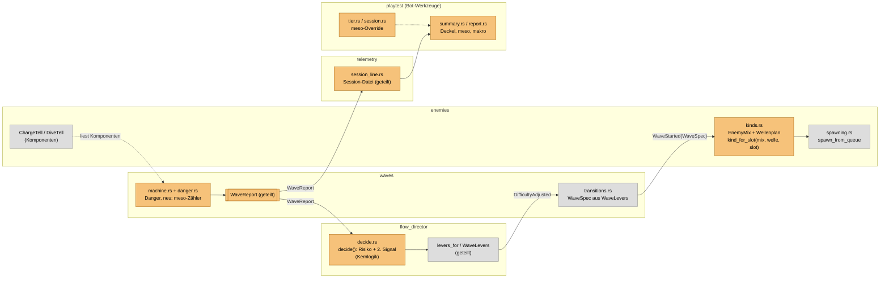
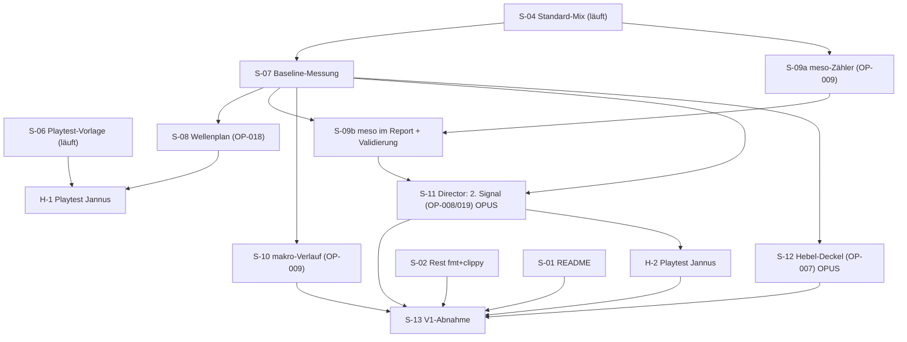

# PLAN Arena-flow – bis V1

> **Plan-Entwurf r1 (Planer, 2026-11-17), nicht entschieden.** Basis: Ist-Stand des Leiters (2026-11-10, Nachtrag 2026-11-17 nach #25), Repo-Stand main = #25 + Doku-PR #26.
> Belegt ist, was eine Quelle hat (Pfad:Zeile, PR, Chat Jannus). Alles mit **Vorschlag** oder **Annahme (Planer)** ist nicht entschieden; Jannus entscheidet, der Leiter stellt die Boxen.
> Balance-Zahlen in diesem Plan sind nur **PLACEHOLDER-Vorschläge**. Pfad:Zeile geprüft am 2026-11-17 auf diesem Stand.
> Miro-/Canvas-Link: noch keiner.

## 0. Kurzfassung
- **V1 = fertiger Testaufbau für den Flow-Director** (Entscheidung Jannus, OP-001). Danach wird ein Spiel daraus; Game-Over, HUD, Menüs, Assets und echte Sounds gehören nach V1 (OP-016, OP-017).
- Was „fertig“ heißt, schlägt Abschnitt 2 als prüfbare Kriterien vor (K1–K9). **Jannus entscheidet** sie, erst dann ist S-13 (Abnahme) schneidbar.
- Weg dorthin: erst messen (S-07 Baseline), dann Inhalte (S-08 Wellenplan), dann das Messinstrument erweitern (S-09a/b meso, S-10 makro), erst danach die Kernlogik des Directors anfassen (S-11, S-12, beide Opus), zum Schluss Kriterien als Tests (S-13).
- Laufend: S-04 (Standard-Gegnermix) und S-06 (Playtest-Vorlage). Bewusst offen: OP-003 (Pickup-Regelwerk) und OP-012 (fehlende Design-Dateien); der Plan trifft dazu keine Annahme, S-03 und S-05 bleiben geparkt.
- Vier Richtungsfragen (OP-007, OP-008, OP-009, OP-019) und der Wellenplan (OP-018) stehen in Abschnitt 4 und 5 als Optionen mit Empfehlung, **nicht entschieden**.

## 1. Ziel und Ist-Stand

### Ziel (laut README, Stand heute)
- 2D-Top-down-Wave-Arena als **Testaufbau für einen Flow-Channel-Difficulty-Director**: nach jeder Welle schiebt der Director die Schwierigkeit so, dass die nächste Welle knapp über der jüngsten Spielerleistung liegt (README.md:3–5).
- „This is a test harness, not a game.“ (README.md:7)
- Leitbild aus CLAUDE.md „Design north star“: „Simple on the surface, deep in mechanics and optimization“, Referenz Devil Daggers; der Director soll das Spiel für jede Skill-Stufe fordernd halten; Pickups haben immer einen Preis.
- Entscheidung Jannus 2026-11-10 (Box, OP-001): V1 ist erst der fertige Testaufbau für den Flow-Director, danach wird ein Spiel daraus.

### Kernidee: Flow-Modell (Quelle: Chat Jannus 2026-11-10)
Ersetzt inhaltlich die fehlende `design/risk-flow-curve.png` (OP-012).
- Klassischer Flow-Graph: x-Achse Skill, y-Achse Challenge, der Flow-Kanal verläuft diagonal nach oben rechts.
- Man ist im Flow, wenn die Challenge knapp über dem Skill liegt.
- Skill hat 3 Bereiche: **mikro** (Zielen und Bewegen), **meso** (Entscheidungen innerhalb einer Welle), **makro** (Strategie über viele Wellen).
- Der Director arbeitet wie ein komplexes System, passt sich automatisch an den Spielertyp an und hält ihn möglichst lange im Kanal (schwerer, aber nicht zu schwer).

### Ist-Stand im Code (geprüft 2026-11-17, main = #25, Code unverändert seit #22)
- **Director misst bisher nur mikro**, und zwar indirekt: `wave_risk` = Anteil der hp, den eine Welle kostet (1 bei Tod), geglättet und in ein Band gesteuert (src/flow_director/decide.rs:76–82, :103–117). Der Code sagt selbst: liest nur mechanischen Druck, Entscheidungen und Gegner-Lesen nicht (src/flow_director/curve.rs:5–8). Die Code-Kurve ist Risiko → Engagement, kein Skill-/Challenge-Graph.
- **Hebel:** genau drei (Anzahl, Tempo, Kontaktschaden), linear je Stufe (src/flow_director/decide.rs:140–156, `WaveLevers` in src/flow_director/difficulty.rs:107–113). Schwierigkeit 1,0–10,0 in Viertelschritten (src/flow_director/difficulty.rs:10–53).
- **Gedächtnis des Directors:** nur eine geglättete Risikozahl (`DirectorMemory`, src/flow_director/decide.rs:56–61).
- **meso:** wird nur gemessen, nicht gesteuert. `Danger` zählt Beinahe-Treffer, Treffer-Annäherungen, Bedrohungs- und Ruhezeit, Gedränge (src/waves.rs:97–120, Messung src/waves/danger.rs:24–63); Bot-Stufen haben Entscheidungs-Parameter wie Tells lesen und Prioritätsziel (src/playtest/tier.rs:148–175, `focuses_priority` :167, `reads_tells` :169). Novice und Casual lesen keine Tells, Skilled und Expert schon (Stufen-Tabelle ab src/playtest/tier.rs:192).
- **makro:** nur offline in den Bot-Werkzeugen: `strategy_search` prüft, ob eine Pickup-/Spend-Strategie überall gewinnt („macro difficulty as consequence“, src/playtest/strategy.rs:1–10). Der Director nutzt das nicht.
- **Spielertyp-Anpassung:** gibt es nicht (OP-019).
- **Gegnermix:** `EnemyMix` kennt `Grunts` (Default), `With(eine Art)`, `All` (src/enemies/kinds.rs:56–65); welche Art einen Slot füllt, hängt nur vom Mix und der Slot-Nummer ab, nicht von der Welle (src/enemies/kinds.rs:222–230, Aufruf src/enemies/spawning.rs:128). S-04 ändert den Default (läuft).
- **Messinstrument:** Der Bot-Report bewertet Wellen auf der Flow-Kurve (flow score, in flow, bored, overwhelmed; src/playtest/summary.rs:39–47) und zusätzlich gegen das Band des Directors: `Summary::of` nimmt `DirectorConfig::default()` (src/playtest/summary.rs:62). Einen Anteil „Wellen am Deckel“ zeigt der Report nicht; die 57–70 % aus OP-007 stammen aus PR #12.
- **Agent-Playtests:** `agent_play` lässt einen Agenten jede Welle mit −2 (bored) bis +2 (overwhelmed) bewerten (`Feel`, src/playtest/agent_view.rs:251–258).
- **Tests:** `tests/playtest_tiers.rs` prüft nur expert > novice (Funktion ab :38), mit `EnemyMix::Grunts` (:25–27). Einen Test, der zwei gleiche Läufe vergleicht, habe ich per `rg determin tests/` nicht gefunden.
- **CI:** `cargo test` auf jedem PR und Push nach main seit #25 (`.github/workflows/test.yml`); fmt/clippy fehlen (OP-014).

### Erkennbare Nicht-Ziele (README.md:171–177, „Intentionally not built“)
- Game-Over-Screen, Run-Restart, Menüs außer dem Debug-Overlay
- Release-HUD (hp, aktive Effekte)
- Assets, Sprites, Animation, Fonts über Bevys Standard (Sound gibt es hinter `fx`, OP-013)
- Upgrades, Shops, Bosse, prozedurale Räume, Netzwerk, Spielstände
- Balance: jede Zahl ist Platzhalter

**Vorschlag (Planer):** Alle diese Punkte bleiben auch für V1 Nicht-Ziele, weil V1 der Testaufbau ist (OP-001); sie wandern in die Spiel-Phase danach (OP-016, OP-017). Ebenso kein Feinschliff der Balance über das hinaus, was ein Kriterium aus Abschnitt 2 verlangt (OP-005, OP-006).

## 2. Was „fertiger Testaufbau für den Flow-Director“ heißt – Erfolgskriterien (Vorschlag)
**Alles in diesem Abschnitt ist Vorschlag des Planers. Jannus entscheidet Kriterien und Schwellen.** Schwellen sind PLACEHOLDER und werden erst nach der Baseline (S-07) festgezurrt, damit sie zum gemessenen Stand passen und nicht geraten sind.

Gemessen wird immer mit dem Bot-Report (`cargo run --release --example playtest`), Standard-Gegnermix bzw. Wellenplan, Pickups `classic` (Default, solange OP-003 offen ist), Director an. Bewertet wird auf der Flow-Kurve (flow score, in flow, bored, overwhelmed), **nicht** mit „risk in band“, weil dieses Maß am Band des Directors selbst hängt (src/playtest/summary.rs:62) und sich bei jeder Director-Änderung mitverschiebt.

| Nr. | Kriterium (Vorschlag) | Prüfung | Schwelle (PLACEHOLDER-Vorschlag) |
|---|---|---|---|
| K1 | **Rangfolge:** Der Director ordnet alle vier Bot-Stufen streng steigend ein (settled diff novice < casual < skilled < expert). | Test in `tests/playtest_tiers.rs` (S-13) | streng monoton, 1 Seed, 4 sim. Minuten wie heute |
| K2 | **Im Kanal je Stufe:** jede Stufe verbringt einen Mindestanteil der Wellen im Flow und wenig gelangweilt oder überfordert. | Flow-Tabelle des Reports | in flow ≥ 50 %, bored ≤ 20 %, overwhelmed ≤ 20 % je Stufe |
| K3 | **Kein Deckel-Anschlag:** Skilled/Expert stehen selten am Deckel (Difficulty 10), auch mit der stärksten Waffe. | neue Spalte „am Deckel“ (S-07), `--matrix` | ≤ 10 % der Wellen je Stufe × Waffe |
| K4 | **Drei Skill-Bereiche getrennt messbar:** der Report zeigt je Session mikro, meso und makro als eigene Zahlen (Definition aus OP-009). | Report-Spalten (S-09b, S-10) | vorhanden, und je Bereich ein Bot-Paar, das sich nur in diesem Bereich unterscheidet und messbar verschieden abschneidet |
| K5 | **Spielertyp-Reaktion** (nur falls OP-019 nicht „nicht in V1“): zwei Bots mit gleichen Händen, aber verschiedenem meso-Verhalten, bekommen messbar verschiedene Wellen (Hebel oder Mix). | Test (S-11/S-13) | Unterschied in mindestens einem Hebel über die zweite Hälfte |
| K6 | **Mensch im selben Instrument:** Jannus' Sessions erscheinen mit `--human` in denselben Tabellen; mindestens zwei menschliche Playtests mit Vorlage (S-06), einer davon ≥ 15 min. | playtest-notes/ + `--human` | Flow-Selbsteinschätzung ≥ 6/10 in beiden |
| K7 | **Reproduzierbar:** zwei gleiche Report-Läufe liefern identische Tabellen. | Test (S-13) | identisch |
| K8 | **Technik grün:** `cargo fmt --check`, `cargo clippy --all-targets -- -D warnings`, `cargo test` laufen in CI (OP-014). | CI | grün |
| K9 | **Doku stimmt:** README und ARCHITECTURE beschreiben den Code (keine Treffer der verworfenen Begriffe aus Abschnitt 8). | `rg` aus Abschnitt 8 | keine Treffer |

Anmerkungen:
- K2 für Novice kann an der Untergrenze (Difficulty 1) scheitern; der Report zeigt das als „am Boden“ (S-07). Falls ja, ist das eine eigene Frage an Jannus (Untergrenze senken oder Novice als „unter dem Testaufbau“ ausweisen), keine Annahme.
- K6 ist subjektiv und eine Person; als Gegengewicht zu den Bots gedacht, nicht als Messung. Jannus kann K6 streichen oder die Schwelle ändern.
- **Pickups:** Die Kriterien gelten mit `classic`, weil OP-003 bewusst offen ist. Ob V1 ohne entschiedenes Pickup-Regelwerk „fertig“ sein kann, ist eine offene Frage an Jannus, keine Annahme dieses Plans.

## 3. Architektur der V1-Änderungen

### Betroffene Domänen
| Domäne / Teil | Was sich in V1 ändert (je nach gewählter Option) | Slices |
|---|---|---|
| `enemies` (kinds.rs, spawning.rs) | Default-Mix (S-04); Wellenplan: Art je Slot hängt zusätzlich vom Wellenindex ab | S-04, S-08 |
| `waves` (waves.rs, machine.rs, danger.rs) | neue meso-Zähler in `WaveReport` (Tells gesehen/ausgewichen) | S-09a |
| `flow_director` (decide.rs, difficulty.rs, flow_director.rs) | zweites Signal (Danger/meso), ggf. neuer Hebel oder Deckel | S-11, S-12 |
| `telemetry` (session_line.rs) | neue Felder in der Session-Datei, alte Dateien müssen lesbar bleiben | S-09a, S-11 |
| `playtest` (summary.rs, report.rs, session.rs) | Spalten „am Deckel/am Boden“, meso, makro; Override für meso-Verhalten in `SessionConfig` | S-07, S-09b, S-10 |
| `examples/playtest.rs`, `tests/playtest_tiers.rs` | Default-Mix, Abnahmetests | S-07, S-08, S-13 |
| unverändert | `app_setup`, `arena`, `camera`, `player`, `weapons`, `combat`, `pickups`, `debug_render`, `fx` | – |

### Datenfluss V1 (Mermaid)
Orange = ändert sich in V1, grau = unverändert, gestrichelt = Lesen ohne Message bzw. Bot-Werkzeuge (kein Gameplay-Plugin).

`LEVERS` wird nur orange, wenn OP-007 einen neuen Hebel wählt (S-12). `waves` liest Gegner-Komponenten heute schon (src/waves/danger.rs:30), ein Lesen der Tell-Komponenten wäre also kein neuer Abhängigkeits-Typ; ob das reicht oder ein Fakt aus `enemies` nötig ist, klärt S-09a beim Pfade-Prüfen.

### Geteilt (Risikoliste Nr. 1)
Jede Slice, die eins davon ändert, ist Risiko → Kritikrunde vor dem Merge.

| Nr. | Geteiltes Element | Fundstelle | Wer hängt dran |
|---|---|---|---|
| G1 | `WaveReport` (Struktur) | src/waves.rs:69–95 | flow_director (`decide`, `wave_risk`), telemetry (Session-Datei), playtest (summary, agent_view), Struktur-Literale in Tests (z. B. src/flow_director/decide.rs:173–192, Tests in src/playtest/summary.rs ab :146) |
| G2 | `Danger` | src/waves.rs:97–120 | Session-Datei (`#[serde(default)]`, src/telemetry/session_line.rs:35–37), Report |
| G3 | `WaveLevers`, `DifficultyAdjusted`, `DecisionReason` | src/flow_director/difficulty.rs:74–126 | waves (src/waves/measure.rs:19, src/waves/transitions.rs:106–113), telemetry (Grund als Text in der Session-Datei), Watch-Label |
| G4 | `WaveSpec` | src/waves.rs:39–49 | enemies (Spawn-Queue src/enemies/spawning.rs:95–102, Werte je Art) |
| G5 | `Difficulty` (MIN/MAX, Viertelschritte) | src/flow_director/difficulty.rs:10–53 | überall; `--sweep` zählt fest 1..=10 (examples/playtest.rs:155) |
| G6 | `EnemyMix` + `ARENA_ENEMIES` / `--enemies` | src/enemies/kinds.rs:51–102, src/enemies.rs:64–69 | playtest (session.rs, watch.rs), examples/playtest.rs:184–186, :284, :349–351, :390–392, examples/strategy_search.rs:75 |
| G7 | `DirectorConfig::default()` als Maßstab des Reports | src/flow_director/decide.rs:6–37, src/playtest/summary.rs:62 | jede Änderung am Band ändert „risk in band“ im Report |
| G8 | Session-Datei-Format | src/telemetry/session_line.rs | Jannus' alte `playtests/*.jsonl` müssen mit `--human` lesbar bleiben |
| G9 | Flow-Kurve `engagement`, `FLOW_PEAK`, `IN_FLOW` | src/flow_director/curve.rs:10–27 | Report-Bewertung, damit alle Kriterien aus Abschnitt 2 |

Weitere Risiko-Gründe: Kernlogik = `decide()` und `levers_for()` (Risikoliste Nr. 3), Opus-Slices (Nr. 4), Lösch-Code in S-05 (Nr. 2).

## 4. Richtungsfragen mit Optionen (nicht entschieden)
Jede Frage: 2–3 Optionen, Vor-/Nachteile, Empfehlung des Planers. **Jannus entscheidet.** Messen vor Umbauen: Die Empfehlungen setzen voraus, dass S-07 (Baseline) vorher läuft.

### 4.1 OP-009 · Wie werden meso und makro gemessen?
**meso (Entscheidungen innerhalb einer Welle)**

| Option | Idee | Vorteile | Nachteile |
|---|---|---|---|
| M-A Aus Danger ableiten | Ausweichquote = Beinahe-Treffer / (Beinahe-Treffer + Treffer-Annäherungen), dazu Ruhezeit-Anteil; alles schon in `Danger` | kein neuer Zähler, schon in Report und Session-Datei, kein Risiko | mischt mikro (Bewegen) und meso; sieht keine Entscheidung direkt |
| M-B Entscheidungs-Ereignisse zählen | je Welle: Tells gesehen / Tells ausgewichen (Charger-Dash, Swarm-Dive), optional Zeit bis ein Summoner fällt | misst genau die Bot-Parameter `reads_tells` / `focuses_priority`, damit validierbar; passt zum Standard-Mix Charger + Swarm (OP-002) | neue Felder in `WaveReport` (G1) und Session-Datei (G8), neue PLACEHOLDER (was zählt als „ausgewichen“), hängt am Gegnermix |
| M-C Bot-Vergleich offline | meso = Unterschied im Ergebnis zwischen Bot mit und ohne meso-Verhalten bei gleichen Händen und gepinnter Schwierigkeit | sauber getrennt, kein Gameplay-Code | nur offline; der Director und menschliche Spieler bekommen keine Zahl |

**Empfehlung:** M-B als meso-Zahl, M-A als billige Zusatzspalte, M-C als Beweis, dass M-B wirklich meso misst (Bot-Paar mit gleichen Händen, nur Tells an/aus).

**makro (Strategie über viele Wellen)**

| Option | Idee | Vorteile | Nachteile |
|---|---|---|---|
| A-A Verlauf über Wellen | Trend der eigenen Leistung über die Session (z. B. Risiko-Trend bei gleicher Schwierigkeit, Erholung nach Tod) | sofort messbar, unabhängig von Pickups | misst eher Lernen und Anpassung als Strategie; Bots lernen nicht, Validierung nur über `agent_play` mit `skill LEVEL` (ändert aber die Hände, also mikro) |
| A-B Ressourcen-Entscheidungen über Wellen | Pickup-/Shard-Timing, Sparen vs. Ausgeben als makro-Zahl | trifft das Devil-Daggers-Leitbild (Tiefe aus Gem-Sammeln) | **hängt an OP-003**, das bewusst offen ist; vorher nicht schneidbar |
| A-C makro nur offline in V1 | `strategy_search` bleibt das makro-Maß, der Director nutzt makro in V1 nicht | ehrlich, kein Umbau, Werkzeug existiert | Jannus' Modell hat drei Bereiche, live gemessen wären nur zwei |

**Empfehlung:** Für V1 A-C plus A-A als Report-Spalte (S-10); A-B erst nach OP-003. Folge: K4 gilt für makro dann nur offline. Das ist eine Inhaltsentscheidung für Jannus.

### 4.2 OP-008 · Geht Danger in die Steuerung?
| Option | Idee | Vorteile | Nachteile |
|---|---|---|---|
| D-A Nein, nur Report (Ist) | Director bleibt bei `wave_risk` | Kernlogik stabil, ein klares Signal | eine Welle ohne Schaden, aber mit vielen Beinahe-Treffern liest als „bored“; der Director erhöht, obwohl der Spieler gefordert war |
| D-B Danger in die Risikozahl mischen | Risiko = `wave_risk` + Gewicht × normierte Beinahe-Treffer (Gewicht PLACEHOLDER) | `decide()` behält seine Form, leicht zu testen | mischt Einheiten, ein Gewicht mehr zu tunen, hp-Risiko und Gedränge gleichen sich unsichtbar aus |
| D-C Danger als Bremse | „anheben“ nur, wenn die Welle auch ruhig war (Bedrohungszeit-Anteil unter PLACEHOLDER); neuer Entscheidungsgrund im Overlay | asymmetrisch und vorsichtig, Grund bleibt lesbar, ändert nichts an „zu riskant“/„Tod“ | neue `DecisionReason`-Variante (G3, Text in Session-Datei), ein Zustand mehr |

**Empfehlung:** Erst mit S-07 messen, ob es „bored, aber knapp“-Wellen überhaupt nennenswert gibt. Wenn ja: D-C (S-11). Wenn nein: D-A, OP-008 schließen.

### 4.3 OP-007 · Hebel-Deckel
| Option | Idee | Vorteile | Nachteile |
|---|---|---|---|
| H-A Deckel anheben | `Difficulty::MAX` über 10, Hebel linear weiter | klein im Code | nur „mehr vom Gleichen“ (Anzahl, Tempo, Schaden), gegen das Leitbild (Tiefe aus Gegner-Design); `Difficulty` ist geteilt (G5), `--sweep` zählt fest 1..=10; Tempo-Grenzen (z. B. `dash_cap`, src/enemies/movement.rs:50) müssen mit |
| H-B Neuer Hebel Zusammensetzung | höhere Stufe = mehr Sonderarten im Mix | passt zum Leitbild und zu OP-018, nutzt vorhandene Arten | Kernlogik und `enemies` hängen enger zusammen (`WaveLevers` bekommt ein Feld, G3/G4); sinkt die Stufe, verschwinden Arten wieder |
| H-C Deckel akzeptieren | Experten am Deckel = „Testaufbau zu leicht für diese Stufe“, als Ergebnis ausgewiesen | kein Risiko | K3 fällt weg oder wird aufgeweicht |

**Empfehlung:** Erst S-07: die 57–70 % stammen aus PR #12, mit reinen Grunts und vor Charger-Cap und Swarm. Bleibt der Anteil mit Standard-Mix über der K3-Schwelle, H-B, und zwar zusammen mit OP-018 entschieden (Option W-C unten). Sonst H-C.

### 4.4 OP-019 · Spielertyp
| Option | Idee | Vorteile | Nachteile |
|---|---|---|---|
| T-A Skill-Vektor statt Typ | Director führt mikro und meso getrennt geglättet und wählt danach den Hebel (hoch mikro, niedrig meso → mehr Masse; hoch meso → mehr Sonderarten) | folgt direkt aus der Messung, testbar mit Bot-Paaren (K5) | braucht zwei Hebel mit verschiedener Wirkung (OP-007 H-B), mehr Kernlogik |
| T-B Feste Typ-Profile | Session wird einem Profil zugeordnet (Namen von Jannus), Profil setzt Gewichte der Hebel | für Menschen gut erklärbar, Grund im Overlay lesbar | Schwellen der Zuordnung wären erfunden (PLACEHOLDER), harte Sprünge, kaum menschliche Daten zum Prüfen |
| T-C Nicht in V1 | V1 passt sich an eine Zahl an, Spielertyp kommt mit dem Spiel | V1 kleiner, weniger Kernlogik-Risiko | ein Kernsatz aus Jannus' Flow-Modell bleibt offen |

**Empfehlung:** T-A in kleinster Form (zwei Signale, zwei Hebelgruppen), aber nur, wenn S-09b zeigt, dass meso sich messbar von mikro trennt. Sonst T-C, K5 entfällt.

## 5. Wellenplan weitere Gegnerarten (OP-018, Optionen)
Entschieden (OP-002): Start mit Grunt + Charger + Swarm. Offen: ab wann Shooter, Brute, Summoner kommen. Heute kann `kind_for_slot` die Welle nicht sehen (src/enemies/kinds.rs:222–230); `WaveSpec` mit `index` liegt beim Spawnen aber schon in der Queue (src/enemies/spawning.rs:95–102), der Umbau bleibt also lokal in `enemies`.

| Option | Idee | Vorteile | Nachteile |
|---|---|---|---|
| W-A Nach Wellenindex | feste Zeitleiste wie in Devil Daggers: neue Art ab Welle N, bleibt danach drin | einfach, deterministisch, lesbar, nur `enemies` betroffen | Welle ≠ Können: Novices bleiben lange in frühen Wellen (Wiederholung nach Tod behält den Index); jede neue Art ist ein Sprung im Risiko, den der Director erst nachregeln muss |
| W-B Nach Schwierigkeit | Art ab Stufe X, also ein Director-Hebel (= OP-007 H-B) | Zusammensetzung wächst mit dem Können, gibt Experten Luft unter dem Deckel | Kernlogik; Arten verschwinden, wenn die Stufe fällt (Flackern); Inhalt und Director-Tuning vermischt |
| W-C Hybrid | Freischalten nach Wellenindex (bleibt), Anteil nach Schwierigkeit | Fortschritt und Skalierung | zwei Stellschrauben zu tunen, größte Slice |

Vorschlag Reihenfolge (für alle Optionen): **Shooter → Brute → Summoner.** Begründung: Shooter bringt ein neues Ausweichmuster (Bolts, mikro), Brute ein Prioritätsziel ohne Zusatzgegner, Summoner zuletzt, weil er Wellen verlängert und die meisten Entscheidungen verlangt (meso).
PLACEHOLDER-Vorschlag für W-A: Shooter ab Welle 6, Brute ab Welle 10, Summoner ab Welle 14 (nur Startwerte zum Messen, nicht durch Daten begründet).

**Empfehlung:** W-A jetzt (S-08, kleine Sonnet-Slice, nur `enemies`), danach gegen S-07 messen. W-B/W-C nur zusammen mit einer Entscheidung für OP-007 H-B.

## 6. Slices bis V1

### Reihenfolge und Abhängigkeiten

- Parallel möglich (keine gemeinsame Datei): S-01 ∥ S-07; S-08 ∥ S-09a (S-08 ändert `enemies`, Beispiele und `tests/playtest_tiers.rs`, S-09a `waves`, `telemetry` und Test-Literale; Annahme (Planer): keine gemeinsame Datei, vor Start mit `git diff --stat` beider Branches prüfen). Nicht parallel: S-07 ∥ S-09b ∥ S-10 (alle `summary.rs`/`report.rs`), S-11 ∥ S-12 (beide `decide.rs`).
- Annahme (Planer) zu Aufwänden: Die Laufzeit eines Report-Laufs ist nicht gemessen; ich rechne mit wenigen Minuten im Release-Build plus einem vollen Bevy-Build (CI braucht für `cargo test` ca. 15 min laut STAND.md).

### Laufend (nicht neu planen)
- **S-04 · Standard-Gegnermix Grunt + Charger + Swarm** – läuft. Für S-07 wichtig: ob S-04 auch den Default in `examples/playtest.rs:184–186` und `tests/playtest_tiers.rs:25–27` umstellt. Falls nicht, übernimmt S-07 Punkt 1.
- **S-06 · Playtest-Vorlage** – läuft (Branch `feat/s-06`). Grundlage für H-1/H-2 und K6.

### Doku/Infra (Texte in Anhang A)
- **S-01 · README an den Code angleichen** – gültig, sonnet low, ca. 5–10 min, S, OP-013. Empfehlung: nach S-04 laufen lassen, damit der neue Default gleich drinsteht.
- **S-02 Rest · fmt + clippy in CI** – wartet auf OK von Jannus (OP-014), sonnet low, ca. 5–10 min, S. Für K8 nötig.
- **S-03 · Design-Unterlagen ins Repo** – geparkt, wartet auf OP-012 (bewusst offen).
- **S-05 · Pickup-Regelwerk eingrenzen** – geparkt, wartet auf OP-003 (bewusst offen). Kein Teil des V1-Pfads, bis Jannus entscheidet.

---

**S-07 · Baseline-Messung V1** · Ziel: bevor neue Features kommen, mit dem Standard-Mix messen, wo die vier Stufen landen, wie oft sie am Deckel/Boden stehen und ob „bored, aber knapp“-Wellen vorkommen (CLAUDE.md „Process“; Grundlage für K2/K3, OP-007, OP-008) · Abhängigkeiten: S-04 gemergt
Was:
1. Falls S-04 es nicht getan hat: Default-Mix in `examples/playtest.rs:184–186` auf den S-04-Mix stellen (Name laut S-04-PR).
2. `Summary` um drei Anteile ergänzen: Wellen bei `Difficulty::MAX`, Wellen bei `Difficulty::MIN`, Anteil der „bored“-Wellen mit mindestens einem Beinahe-Treffer (`danger.close_calls > 0`). Reine Logik, Unit-Test in derselben Datei.
3. Die drei Anteile als Spalten in die Flow-Tabelle (`flow_table`).
4. Report laufen lassen: `cargo run --release --example playtest -- --matrix --seeds 3` (Standard-Mix) und dasselbe mit `--enemies all`; Ergebnis mit 5–10 Zeilen Befund nach `playtest-notes/<datum>-bot-baseline.md` (Datum des Laufs).
5. Den ersten Lauf einmal wiederholen und vermerken, ob die Tabellen identisch sind (Vorgriff auf K7).
Pfade: src/playtest/summary.rs:15–54 (Struktur), :56–130 (`Summary::of`), Tests ab :146; src/playtest/report.rs:46–70 (`flow_table`); examples/playtest.rs:184–186; playtest-notes/ (neue Datei)
Fertig wenn: neue Spalten erscheinen im Report; Unit-Test deckt leere Session (0 Wellen → 0 %, kein Panic) und eine Session ganz am Deckel ab; Baseline-Datei enthält beide Läufe und den Befund zu Deckel-Anteil je Stufe × Waffe und „bored, aber knapp“; `cargo test` grün.
Nicht-Ziele: Director, Werte, Gegner ändern; Schwellen für K2/K3 festlegen (macht Jannus).
Test: `cargo test --lib playtest::summary`
Modell + Effort: sonnet medium · Aufwand: ca. 25–40 min (Report-Läufe eingerechnet, Annahme), M
OPs: OP-007, OP-008, OP-005 (Werte bleiben Platzhalter)

---

**S-08 · Wellenplan: weitere Gegnerarten nach Wellenindex** · Ziel: Shooter, Brute und Summoner kommen in späteren Wellen zum Standard-Mix dazu, damit die Tiefe über die Zeit wächst (OP-002/OP-018) · Abhängigkeiten: S-04 und S-07 gemergt (Vergleichsbasis), **OP-018 entschieden (blockierend); hier für Option W-A geschnitten**
Was:
1. `kind_for_slot` bekommt den Wellenindex zusätzlich zur Slot-Nummer; der Aufruf in `spawn_from_queue` reicht `spec.index` aus der Queue durch.
2. Neue `EnemyMix`-Variante für den Wellenplan (Name Vorschlag: `Staged`, Executor darf passender benennen) mit PLACEHOLDER-Konstanten „ab Welle N“ je Art direkt daneben; Slot-Muster für die zusätzlichen Arten nach dem bestehenden `ALL_MIX`-Prinzip; Reihenfolge laut Entscheidung (Vorschlag Shooter → Brute → Summoner).
3. Wellenplan wird Default (Spiel, Playtest-Beispiel, `tests/playtest_tiers.rs`); der reine S-04-Mix und alle bisherigen Mixe bleiben über `ARENA_ENEMIES` / `--enemies` wählbar; `FromStr`/`Display` und die Namens-Matches im Beispiel ergänzen.
4. Unit-Tests: Welle 1 enthält nur Grunt/Charger/Swarm; ab der jeweiligen Startwelle taucht die Art auf; gleiche Eingabe → gleiche Folge.
5. Report vorher/nachher (`--matrix`, Default) in den PR-Text; README und ARCHITECTURE-Abschnitt „Enemy kinds“ anpassen.
Pfade: src/enemies/kinds.rs:51–102, :165–230 (+ Tests ab :232); src/enemies/spawning.rs:95–130; src/enemies.rs:64–69; examples/playtest.rs:184–186, :284, :349–351, :390–392; examples/strategy_search.rs:75; tests/playtest_tiers.rs:25–27; README.md; ARCHITECTURE.md:161–188
Fertig wenn: `cargo run` ohne Env spielt den Wellenplan; jeder bisherige Mix-Name funktioniert noch; ein unbekannter Name gibt weiter die Fehlermeldung; Unit-Tests aus Punkt 4 grün; `tests/playtest_tiers.rs` grün.
Nicht-Ziele: Werte der Arten (OP-005), Director-Hebel (OP-007), Anteil nach Schwierigkeit (W-B/W-C).
Test: `cargo test --lib enemies::kinds`
Modell + Effort: sonnet medium · Aufwand: ca. 25–40 min, M · Risiko: `EnemyMix` geteilt (G6, Risikoliste Nr. 1)
OPs: OP-002, OP-018, OP-005

---

**S-09a · meso-Zähler in der Welle** · Ziel: je Welle zählen, wie viele Tells (Charger-Dash, Swarm-Dive) der Spieler gesehen hat und wie vielen er ohne Treffer ausgewichen ist, als Grundlage einer meso-Zahl (OP-009, Option M-B) · Abhängigkeiten: S-04 gemergt, **OP-009 meso entschieden (blockierend)**
Was:
1. Pfade prüfen: `ChargeTell`/`DiveTell` (src/enemies.rs:26–40) und wo sie gesetzt werden (src/enemies.rs:139–162); ob `waves` sie wie in `danger.rs` direkt lesen kann. Ist ein neuer Fakt aus `enemies` nötig, stoppen und als Blocker melden (Architekturfrage für den Kritiker).
2. Neue Zähler in den Wellen-Stats und ein neues Feld in `WaveReport` (eigene kleine Struktur neben `Danger`, Name wählt der Executor); „ausgewichen“ = Tell endete, ohne dass dieser Gegner in diesem Anlauf einen Kontakttreffer landete (Regel wie die Beinahe-Treffer in `danger.rs`).
3. Session-Datei: Feld mit `#[serde(default)]` wie `danger` (src/telemetry/session_line.rs:35–37), Round-Trip-Test, eine alte Zeile ohne Feld lädt.
4. Alle `WaveReport`-Struktur-Literale in Tests ergänzen.
Pfade: src/waves.rs:69–120, :154–165 (Plugin-Registrierung); src/waves/machine.rs; src/waves/danger.rs (Muster) bzw. neue Datei unter src/waves/, falls danger.rs sonst über ~200 Zeilen Logik käme; src/telemetry/session_line.rs; src/flow_director/decide.rs:173–192; Tests in src/playtest/summary.rs ab :146
Fertig wenn: Unit-Test: Tell ohne Treffer zählt als ausgewichen, Tell mit Kontakttreffer nicht, Welle ohne Charger/Swarm ergibt 0/0 (kein Teilen durch 0); alte Session-Datei lädt; Report-Ausgabe unverändert (noch keine Spalte); `cargo test` grün.
Nicht-Ziele: Report-Spalte (S-09b), Director-Steuerung (S-11), Summoner-Priorität.
Test: `cargo test --lib waves`
Modell + Effort: sonnet high · Aufwand: ca. 30–45 min, M · Risiko: G1, G8 (Risikoliste Nr. 1)
OPs: OP-009, OP-004 (Bots ignorieren den Swarm-Dive bisher)

---

**S-09b · meso im Report + Validierung** · Ziel: meso als eigene Spalte zeigen und belegen, dass sie meso misst und nicht mikro (K4) · Abhängigkeiten: S-09a und S-07 gemergt
Was:
1. `Summary` + Flow-Tabelle: meso-Quote (ausgewichen / gesehen) und Ausweichquote aus `Danger` (Option M-A).
2. `SessionConfig` bekommt einen Override für das Tell-Lesen (Muster wie `pickup_policy`/`spend`, src/playtest/session.rs:39–42, angewendet ab :53), der `reads_tells` der Stufe überschreibt.
3. Integrationstest: Skilled mit und ohne Tell-Lesen, sonst gleich; meso-Quote mit Tells ist höher, Trefferquote unterscheidet sich höchstens um PLACEHOLDER 5 Prozentpunkte.
4. Report-Lauf (`--matrix`) in den PR-Text.
Pfade: src/playtest/summary.rs; src/playtest/report.rs:46–70; src/playtest/session.rs:25–60; src/playtest/tier.rs:148–175; tests/playtest_tiers.rs
Fertig wenn: Spalten im Report; Test aus Punkt 3 grün; ohne Override sind alle bisherigen Zahlen gleich (Vergleich mit S-07-Baseline).
Nicht-Ziele: Director-Steuerung; neue Bot-Stufen.
Test: `cargo test --test playtest_tiers`
Modell + Effort: sonnet medium · Aufwand: ca. 25–40 min, M
OPs: OP-009

---

**S-10 · makro-Verlauf im Report** · Ziel: makro in V1 sichtbar machen, soweit ohne Pickup-Entscheidung möglich (OP-009, Option A-A + A-C) · Abhängigkeiten: S-07 gemergt, **OP-009 makro entschieden (blockierend)**; entfällt, wenn Jannus A-B wählt (dann nach OP-003)
Was:
1. Reine Logik in `summary.rs`: Erholung nach Tod (Wellen, bis die Wellen-Risikozahl wieder im Flow liegt, Mittel je Session) und Risiko-Trend über die Session (Executor wählt die Normierung auf die Schwierigkeit und begründet sie im PR).
2. Spalte in der Flow-Tabelle; Unit-Tests mit konstruierten Sessions (leer, ein Tod ohne Erholung, steigend/fallend).
3. README: ein Satz, dass makro über Pickups offline über `strategy_search` läuft.
Pfade: src/playtest/summary.rs; src/playtest/report.rs:46–70; README.md
Fertig wenn: Spalte im Report; Tests grün inkl. leere Session und Session ohne Tod.
Nicht-Ziele: Pickup-/Shard-Makro (OP-003), Director-Steuerung.
Test: `cargo test --lib playtest::summary`
Modell + Effort: sonnet medium · Aufwand: ca. 15–25 min, S
OPs: OP-009, OP-003 (bleibt offen)

---

**S-11 · Director: zweites Signal (Danger-Bremse, ggf. meso)** · **OPUS (Kernlogik)** · Ziel: der Director erkennt „bored, aber knapp“-Wellen und unterscheidet, je nach OP-019, Spieler mit gleichem mikro und verschiedenem meso · Abhängigkeiten: S-07, S-09b gemergt; **OP-008 und OP-019 entschieden (blockierend)**; hier geschnitten für D-C + T-A minimal (bei D-A und T-C entfällt die Slice)
Was:
1. `decide()` liest zusätzlich zur Risikozahl den Bedrohungszeit-Anteil der Welle; „anheben“ nur, wenn er unter einer PLACEHOLDER-Schwelle in `DirectorConfig` liegt, sonst neuer Grund „hält: knapp ohne Schaden“ (`DecisionReason`-Variante + Text).
2. Bei T-A: `DirectorMemory` glättet die meso-Quote mit; welche Hebelgruppe sich bewegt, hängt davon ab (setzt S-12 mit H-B voraus, sonst nur Punkt 1).
3. Unit-Tests in `decide.rs` für jede neue Verzweigung, inkl. erste Welle (kein Gedächtnis) und Welle ohne Tells.
4. Report vorher/nachher für alle Stufen (`--matrix`) im PR; K1–K3 gegen S-07 vergleichen.
5. Session-Datei: der neue Grund wird als Text geschrieben und von `--human` gelesen (Round-Trip-Test).
Pfade: src/flow_director/decide.rs:6–54, :56–61, :97–138 (+ Tests ab :158); src/flow_director/difficulty.rs:61–105; src/flow_director.rs:77–96; src/telemetry/session_line.rs; ARCHITECTURE.md:204–226; README.md „How difficulty moves“
Fertig wenn: alle neuen Zweige getestet; ohne Danger (alle Werte 0) entscheidet `decide()` wie vorher (Regressionstest); K1 im Report weiter erfüllt; `cargo clippy --all-targets -- -D warnings` grün.
Nicht-Ziele: neue Hebel (S-12), Band-Werte tunen, Report-Maßstab ändern (G7).
Test: `cargo test --lib flow_director::decide`
Modell + Effort: **opus high** · Aufwand: ca. 30–45 min, M · Risiko: Nr. 1 (G3, G7, G8), Nr. 3, Nr. 4 → Kritikrunde
OPs: OP-008, OP-019, OP-006

---

**S-12 · Hebel-Deckel (OP-007)** · **OPUS (Kernlogik)** · Ziel: Skilled/Expert stoßen nicht mehr am Deckel an (K3) · Abhängigkeiten: S-07 gemergt, **OP-007 entschieden (blockierend)**, bei H-B auch OP-018 (W-B/W-C)
**Nicht ready:** Der Inhalt hängt ganz an der Option (H-A: `Difficulty` und Hebel-Kurve; H-B: neues Feld in `WaveLevers` + `enemies`; H-C: entfällt). Der Planer schneidet die Slice nach der Entscheidung aus; bis dahin keine bedingten AKs.
Vorläufig: Pfade src/flow_director/decide.rs:140–156, src/flow_director/difficulty.rs:10–53, :107–113, src/waves/transitions.rs:106–113, src/enemies/kinds.rs:222–230 · Test: `cargo test --lib flow_director` · Modell + Effort: **opus high** · Aufwand: ca. 30–45 min, M–L · Risiko: Nr. 1 (G3–G5), Nr. 3, Nr. 4 · OPs: OP-007, OP-018

---

**S-13 · V1-Abnahme: Kriterien als Tests + Doku** · Ziel: die von Jannus bestätigten Kriterien laufen automatisch und die Doku beschreibt V1 · Abhängigkeiten: S-08, S-01, S-02 Rest; S-10, S-11, S-12 (jeweils gemergt oder als entfallen entschieden); **Kriterien aus Abschnitt 2 von Jannus bestätigt (blockierend)**
Was:
1. `tests/playtest_tiers.rs`: Rangfolge aller vier Stufen (K1) statt nur expert > novice; Deckel-Anteil (K3) für Skilled/Expert mit der Default-Waffe.
2. Reproduzierbarkeit (K7): `play` zweimal mit gleicher `SessionConfig`, `Summary` gleich.
3. Laufzeit des Testpakets messen; liegt die CI deutlich über heute (ca. 15 min), die Kriterien-Tests mit `#[ignore]` markieren und einen eigenen CI-Schritt nur vorschlagen (Frage an Jannus wegen Actions-Minuten).
4. README/ARCHITECTURE auf V1-Stand; Suche nach den verworfenen Begriffen (Abschnitt 8) ohne Treffer.
5. Abschluss-Report (`--matrix --seeds 3`) als `playtest-notes/<datum>-bot-v1.md` mit ✅/❌ je Kriterium.
Pfade: tests/playtest_tiers.rs:1–63; README.md; ARCHITECTURE.md; playtest-notes/ (neue Datei)
Fertig wenn: alle bestätigten Kriterien haben einen Test oder eine dokumentierte manuelle Prüfung; `cargo test` grün; K9-Suche ohne Treffer.
Nicht-Ziele: Werte tunen, um ein Kriterium zu „schaffen“ (dann eigene Tuning-Slice, OP-005/OP-006).
Test: `cargo test --test playtest_tiers`
Modell + Effort: sonnet medium · Aufwand: ca. 30–45 min, M
OPs: OP-001, OP-007, OP-014

---

**H-1 / H-2 · Menschliche Playtests (Jannus, keine Executor-Slice)** · H-1 nach S-08 (Wellenplan, mit Vorlage aus S-06; Swarm bewusst testen für OP-004), H-2 nach S-11 (spürt man die Bremse?). Session-Log mit `cargo run`, danach `cargo run --example playtest -- --human`. Ergebnis als Notiz in `playtest-notes/`. OPs: OP-004, OP-011, OP-015.

## 7. Entscheidungen (nur im Repo oder Chat belegt)
| Datum | Entscheidung | Entscheider | Quelle |
|---|---|---|---|
| 2026-10-02 | Treffer-Schonzeit nach Schaden (`GRACE_SECS` 0,75 s) | Jannus | PR #12 („Jannus's choice“) |
| 2026-10-02 | Geschaffte Welle füllt hp wieder auf | Jannus | PR #12 („Jannus's choice“) |
| 2026-10-03 | Sound/Partikel behalten, aber getrennt: Feature `fx`, standardmäßig aus; Bots/Headless laden es nie | Jannus | playtest-notes/2026-10-03-sound-und-partikel.md:12–14, :31–34; CLAUDE.md „Architecture rules“ |
| 2026-10-03 | Schwert auf Rechtsklick wird Standard (`ARENA_SWORD=key3` = alte Belegung) | Jannus (Playtest-Urteil „gefällt“), umgesetzt in PR #22 | playtest-notes/2026-10-03-sound-und-partikel.md:15, PR #22 |
| 2026-11-10 | Erst Ist-Stand in STAND.md/OP.md festhalten, dann mit dem Planer einen Plan bis V1 | Jannus | Chat 2026-11-10 (OP-001) |
| 2026-11-10 | V1 ist erst der fertige Testaufbau für den Flow-Director, danach wird ein Spiel daraus | Jannus | Box 2026-11-10 (OP-001) |
| 2026-11-10 | Standard-Gegnermix zu Beginn Grunt + Charger + Swarm, weitere Arten in späteren Wellen; ab welcher Welle, legt der V1-Plan fest | Jannus | Chat 2026-11-10 (OP-002, Rest OP-018) |
| 2026-11-17 | OP-003 (Pickup-Regelwerk) und OP-012 (fehlende Design-Dateien) bleiben bewusst offen; der Plan trifft keine Annahme dazu | Jannus | Auftrag des Leiters an den Planer 2026-11-17 |

Alle Balance-Zahlen sind Platzhalter, keine davon ist entschieden (OP-005, OP-006).

## 8. Verworfene Begriffe (für die Rest-Wahrheiten-Suche)
| Verworfen / irreführend | Stattdessen | Wo heute noch | Wann bereinigen |
|---|---|---|---|
| „Enemies have 3 hp“ | hp je Art (src/enemies/kinds.rs:114–154) | README.md:52 | S-01 |
| „The default mix is grunts only“ / `Grunts` als Default | Standard-Mix Grunt + Charger + Swarm (OP-002), später Wellenplan | ARCHITECTURE.md:166, src/enemies/kinds.rs:58–60 | S-04 / S-08 |
| „three v1 levers“, „in v1“ für die drei Hebel | „die drei Hebel“; **V1** meint nur den Meilenstein „fertiger Testaufbau“ (OP-001) | src/flow_director/decide.rs:140, src/flow_director/difficulty.rs:107, ARCHITECTURE.md:209 | spätestens S-12, sonst S-13 |
| „keine Test-CI“ | Test-CI seit #25, fmt/clippy fehlen | alter PLAN-Text (hier korrigiert) | erledigt |
| `design/risk-flow-curve.png` als vorhandene Quelle | Flow-Modell in Abschnitt 1; Datei fehlt (OP-012) | README.md:88, ARCHITECTURE.md:214, src/flow_director/curve.rs:1 | S-03 (offen) |
| Sound unter „Intentionally not built“ | Sound hinter Feature `fx` | README.md:175 | S-01 |
| „Shards ist entschieden“ | Tendenz Jannus, OP-003 offen | – (nicht verwenden) | – |
| „Spielertyp“ als vorhandenes Modell | gibt es nicht (OP-019) | – (nicht verwenden) | – |
| Bot-Stufe = Spielertyp | Stufe = Bündel messbarer Grenzen (src/playtest/tier.rs:1–2), kein Typ | – | – |
| `wave_risk` = mikro-Skill | `wave_risk` = Ergebnis der Welle (hp-Verlust), liest mikro nur indirekt | – | – |
| „Spiel“ / „game“ für V1 | „Testaufbau“; Spiel erst nach V1 | – | – |

Suche für K9 (Vorschlag): `rg -n "3 hp|grunts only|v1 levers|in v1|risk-flow-curve.png" README.md ARCHITECTURE.md src`

## 9. Ready-Gate-Checkliste (Leiter prüft, Jannus gibt frei)
- [ ] Ziel und Nicht-Ziele für V1 bestätigt (Abschnitt 1, Vorschlag: alle README-Nicht-Ziele bleiben).
- [ ] Erfolgskriterien K1–K9 von Jannus bestätigt, gestrichen oder geändert; Schwellen nach S-07 festgesetzt.
- [ ] Entschieden: OP-009 (meso und makro), OP-018 (Wellenplan), OP-008, OP-019, OP-007 – oder bewusst als „nicht in V1“ markiert.
- [ ] Entschieden, ob V1 ohne OP-003 (Pickups) fertig sein darf.
- [ ] Geteilte Elemente G1–G9 bekannt; jede Slice, die eins ändert, ist als Risiko markiert.
- [ ] Jede Slice hat prüfbare „Fertig wenn“, exakte Pfade und einen gezielten Test; S-12 nach Entscheidung ausgeschnitten.
- [ ] Keine bedingten AKs mehr in S-08, S-09a, S-10, S-11 (Option jeweils entschieden).
- [ ] S-07 (Baseline) gelaufen, Ergebnis in playtest-notes/.
- [ ] Testumgebung geklärt: gezielter Test im Executor, volle Suite am Ende, CI-Laufzeit mit neuen Kriterien-Tests akzeptiert (S-13 Punkt 3).
- [ ] Keine Treffer der verworfenen Begriffe in neuen Texten.
- [ ] Kritiker-Urteil „ready“ (letzte Runde ohne Blockierendes; Ready-Gate-Runde Opus).
- [ ] Jannus hat freigegeben.

Teilstart erlaubt: S-01, S-07 (nach S-04) und S-02 Rest (nach OK) hängen an keiner offenen Richtungsfrage.

## Anhang A · Bestehende Slice-Texte (aus dem Ist-Plan, nur Modell/Effort und Pfade nachgetragen)

**S-01 · README an den Code angleichen** · Ziel: README beschreibt den Ist-Stand, damit Planer und Playtests nicht von veralteten Angaben ausgehen · Abhängigkeiten: keine (Empfehlung: nach S-04)
Was: 1. Gegner-hp-Satz (README.md:52) durch Verweis auf die Arten ersetzen. 2. `ARENA_ENEMIES` (grunt, Artname, all, neuer Default aus S-04) und `ARENA_PICKUPS` (classic, far, shards, shards-range, shards-bolts) dokumentieren. 3. `cargo play` / Feature `fx` und Taste M (stumm) aufnehmen; Sound aus „Intentionally not built“ (README.md:175) nehmen. 4. `strategy_search` und `agent_play` kurz erwähnen.
Pfade: README.md
Fertig wenn: jede genannte Env-Variable und jedes Beispiel existiert im Code; keine Inhaltsentscheidung neu getroffen; `cargo test` unverändert grün.
Nicht-Ziele: Code, Werte, neue Features. · Test: `cargo test` · Modell + Effort: sonnet low · Aufwand: ca. 5–10 min, S · OPs: OP-013

**S-02 · Test-CI für PRs** · **Teilweise umgesetzt in #25** (nur `cargo test`, mit `rust-cache` statt Build-Cache). Rest: fmt + clippy · Ziel: fmt, clippy und Tests laufen automatisch auf jedem PR · Abhängigkeiten: OK von Jannus (OP-014)
Was: 1. `cargo fmt --check` und `cargo clippy --all-targets -- -D warnings` als Schritte in `.github/workflows/test.yml` (Annahme Leiter: im selben Job).
Pfade: .github/workflows/test.yml
Fertig wenn: Workflow läuft auf einem Test-PR grün; ein absichtlicher clippy-Fehler macht ihn rot.
Nicht-Ziele: Release-Builds, Deployment. · Test: CI-Lauf auf dem PR · Modell + Effort: sonnet low · Aufwand: ca. 5–10 min, S · OPs: OP-014

**S-03 · Design-Unterlagen ins Repo** · geparkt · Ziel: Flow-Kurve, Gegner-, Pickup- und Flow-Bericht sowie Playtest-Anleitung für alle Sub-Agents lesbar machen · Abhängigkeiten: Jannus liefert die Dateien (OP-012, bewusst offen)
Was: 1. Dateien nach `docs/` (bzw. `design/` für die Kurve, wie im Code referenziert) übernehmen. 2. Verweise in README.md:88, ARCHITECTURE.md:214, src/flow_director/curve.rs:1 und den Playtest-Notizen prüfen.
Pfade: docs/, design/, ggf. Verweis-Zeilen
Fertig wenn: jeder Verweis im Repo zeigt auf eine vorhandene Datei.
Nicht-Ziele: Inhalte umschreiben. · Test: `rg` auf die Pfade · Modell + Effort: sonnet low · Aufwand: ca. 5 min, S · OPs: OP-012

**S-05 · Pickup-Regelwerk eingrenzen** · geparkt · Ziel: ein klares Pickup-System statt fünf Prototypen · Abhängigkeiten: OP-003 (bewusst offen), OP-010
Was: 1. Gewähltes Regelwerk als Default. 2. Verworfene Varianten samt Bot-Pfaden entfernen. 3. README/ARCHITECTURE anpassen.
Pfade: src/pickups/ (rules.rs, shards.rs, placement.rs, table.rs), src/playtest/choices.rs, examples/strategy_search.rs, README.md, ARCHITECTURE.md
Fertig wenn: nur die gewählten Regelwerke sind auswählbar; `strategy_search` und Tests laufen; Report für Default unverändert, falls Default gleich bleibt.
Nicht-Ziele: neue Pickup-Arten. · Test: `cargo test` · Modell + Effort: sonnet medium · Aufwand: ca. 15–25 min, M · OPs: OP-003, OP-010 · Risiko nach Urteil: Lösch-Code (Risikoliste Nr. 2)
